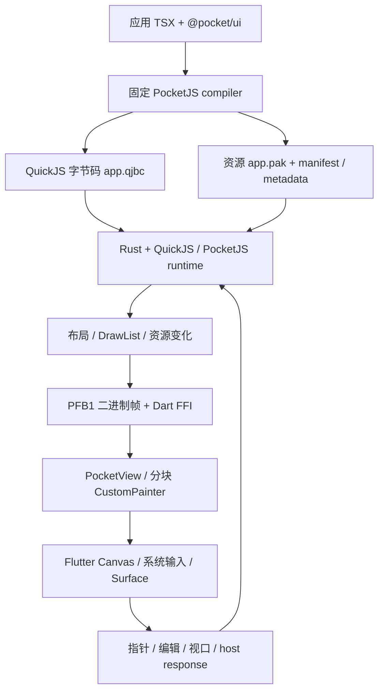

# Pocket

Pocket 是一个可集成到 Flutter App 的 **PocketJS / QuickJS 字节码 SDK**。页面用 TypeScript/TSX 编写，由 JS 负责组件组合、状态、路由、滚动和转场；Flutter 提供绘制表面、系统输入、资源解码、生命周期与显式注册的原生能力。

目标是让同一套 JS 页面运行在薄 Flutter 宿主中，并支持可验证的字节码发布、版本管理、热更新和硬件插件。Showcase 本身也是 JS 应用，用来验证 SDK 的真实能力。

## 从哪里开始

仓库只有两个开发入口：

| 入口 | 内容 |
| --- | --- |
| [`sdk/`](sdk/README.md) | 可复用 SDK：Flutter 公共 API、JS UI 库、Rust/QuickJS runtime、构建链、Editor、更新服务与插件协议。 |
| [`demo/`](demo/README.md) | SDK 的 Showcase 消费者。Flutter 工程在第一层，全部业务 JS/TS 在 [`demo/js/`](demo/js/)。 |

SDK 不依赖 Demo。集成其他项目使用 `pocket_sdk`、`@pocket/ui` 和 `sdk/pocket.ts`，不需要复制 Showcase 的页面或维护另一份 bridge。

## 技术栈与职责

| 技术 / 模块 | 负责什么 |
| --- | --- |
| TypeScript / TSX、Solid 响应式模型 | JS 页面、状态与组件生命周期；不是 WebView，也不需要 DOM。 |
| 固定版本 PocketJS compiler / engine | 编译 JSX、原生节点树、布局、输入推进、DrawList 和资源契约。由 SDK 准备上游源码并应用受控补丁。 |
| QuickJS、Rust、`rquickjs` | 构建时编译 JS 字节码，运行时加载并执行；Rust 管理 runtime、帧投影、FFI 和通讯队列。 |
| Flutter / Dart FFI / Canvas | 将原生帧解码为绘制操作，缓存文字和图片，管理系统 TextField、surface 与生命周期。 |
| `@pocket/ui` | JS 基础 UI、移动样式组件、主题、表单、滚动、响应式布局、转场和 glass/texture 接口。 |
| Swift / Kotlin、Flutter MethodChannel | iOS / Android 硬件 provider，以及系统几何信息等平台能力。高频渲染不依赖 MethodChannel 逐组件调用。 |
| Bun / Python / Cargo | 脚手架、Editor、guest 与 native 构建、上游准备、签包和测试。 |
| Ed25519 / SHA-256 | 更新发布者签名验证、内容完整性校验、内容寻址缓存与资源重建。 |

当前仓库固定 Flutter **3.35.7**（`.fvmrc`）、Dart SDK 约束 **^3.9.2**、Rust 最低 **1.93**，`rquickjs` 由 Cargo 锁定；PocketJS 上游固定为 `99924de47c62fa36f526a8791055d91cbbdb3836`，下载归档会验证 SHA-256，随后应用字节码、执行预算和绘制等受控补丁。若使用 FVM，可将下文 `flutter` 替换为 `fvm flutter`。

上游 compiler 依赖另由准备出的 `sdk/.cache/pocketjs/bun.lock` 锁定，并执行 frozen install；该缓存从固定上游重建，不手工提交。

真实依赖版本由 [`sdk/bun.lock`](sdk/bun.lock)、[`sdk/native/Cargo.lock`](sdk/native/Cargo.lock)、Flutter 各包的锁文件以及 [`prepare_upstream.py`](sdk/scripts/prepare_upstream.py) 中的上游 revision 固定。不要手动修改 `.cache/pocketjs` 后将它当成可复现源码。

### JS 与 Flutter 的分界

Flutter 不为每个 JS 按钮、卡片或列表项创建业务 Widget。JS 组件最终组合成上游基础节点，再由引擎投影成绘制指令。

当前上游 host 节点是 `view`、`text`、`image`、`surface` 四类；历史 Demo 的“38 个组件”包含基础 API 和业务组合，不是必须在 Flutter 中实现的 38 种原生控件。完整对应及支持边界见 [组件契约](sdk/docs/COMPONENTS.md)。

Flutter 中确有必要的系统 Widget，例如 `TextField`、`Texture`、glass filter、诊断标签和承载绘制的容器。这些能力属于宿主适配层，业务页面仍由 JS 编写。

## 从 TSX 到屏幕



1. `build_guest.ts` 使用固定编译器处理应用和公共 UI 包，生成 bundle 与 PAK。
2. `pocketjs_bytecode` 将 bundle 编译成真正的 QuickJS 字节码，生成 ABI、哈希与大小元数据。
3. `PocketSession` 选择内置包或验证过的更新包，进行 capability / permission 协商，创建 bridge。
4. `PocketView` 加载 qjbc/PAK，通过 FFI 推进真实 JS、布局与绘制，消费二进制帧。
5. Dart 将绘制操作交给 Canvas；图片、文字、系统输入与平台纹理由相应宿主设施承接。
6. 指针、编辑状态、host 响应和视口变化回到 Guest，继续使用同一个 runtime。

### QuickJS 预编译字节码的准确含义

这里的预编译是 **构建时生成 QuickJS 二进制字节码，运行时直接加载执行**，不是将业务 JS 编译成 ARM 机器码，也不是 Flutter/Dart AOT 的另一种名称。JS 仍在 QuickJS VM 中执行，GC 和 JS 计算成本仍然存在。

| 产物 | 用途 |
| --- | --- |
| `app.qjbc` | 带 Pocket 字节码头的 QuickJS 可执行字节码。 |
| `app.pak` | 字体、图像等完整运行期资源包。 |
| `app.bytecode.json` | 字节码格式、runtime ABI、哈希、大小、tickHz 与发布身份。 |
| `guest-manifest.json` | Guest 能力/权限声明及发布身份。 |
| `app.js` | 构建诊断和复现产物；生产宿主不将它作为源码 fallback。 |

宿主拒绝格式或 ABI 不匹配的字节码。升级引擎、编译器或相关契约时，必须重新构建对应 Guest，不能假设不同 QuickJS 版本的字节码可互换。

## 高效绘制与降低空闲开销

优化目标是减少不必要的 JS/布局推进、跨语言数据搬运、Dart 解码、Widget 重建、文字排版和 Canvas 重绘。每一层的收益和限制不同。

| 机制 | 如何减少工作 | 边界 |
| --- | --- | --- |
| JS 组件组合、原生 DrawList | 页面不映射成庞大的 Flutter 业务 Widget 树；宿主消费绘制操作。 | 复杂 JS、布局和绘制本身仍有成本；不是所有页面自动变快。 |
| PFB1 二进制帧 | 数值指令与原始像素数据避免完整帧 JSON 的文本化、JSON 数值解析和像素 JSON 数组。 | Dart 仍须复制借用的 native buffer 并解码；事件 payload 仍可包含小 JSON，不是端到端零拷贝。 |
| unchanged / delta 返回 | 原生确认画面未变化后，可避免返回和解码完整视觉帧，继续保留已有画面。 | 判断之前仍可能执行 Guest、布局和比较；不能等同于 native 零工作。 |
| 保留分块与 `RepaintBoundary` | 普通绘制序列按 32 个 DrawOps 分块，未变化分块可复用绘制层。 | Surface/clip 顺序仍须保持；不是只重绘任意一个像素的 GPU 脏矩形系统。 |
| 文字 LRU | 默认最多 256 个 `TextPainter` 排版结果，位置变化不必重复排版，淘汰时释放。 | 文本、样式、约束变化会失效；不是无限缓存。 |
| 图片与资源 revision 缓存 | 按资源身份、revision / epoch 去重和复用解码结果，处理更新与释放。 | 首次解码、上传、缓存失效仍有成本。 |
| 空闲停表 | 连续 6 帧 unchanged 后停止 Flutter ticker；100ms 有界 timer 唤醒只探测一帧，仍 unchanged 就继续停表。 | 仍有探测开销；Guest timer 唤醒存在调度粒度，不是静态页面永久零唤醒。 |
| 输入/消息唤醒 | 指针、controller 消息、视口与生命周期等需要工作时恢复 ticker，避免等到下一次普通探测。 | 当前主要运行链仍受 Flutter UI isolate 调度影响。 |
| 精确帧时钟 | 使用单调调度时间和浮点毫秒 delta，空闲后补上真实 elapsed，避免每帧截断时间造成动画/定时器漂移。 | 长时间间隔有边界处理，不承诺任意后台时间都逐帧补算。 |
| 批量二进制通讯 | 数值事件通过固定记录与批量 reserve/commit 降低 JSON 和 FFI 次数。 | 只适合协议支持的数据；复杂业务对象仍使用结构化消息。 |
| 原生纹理 | 相机/视频等已授权内容通过 Flutter Texture/surface 组合，不把每帧视频像素当 JS JSON 传递。 | provider 必须管理纹理生命周期、权限与设备差异。 |

实现入口：[PocketView](sdk/packages/pocket_flutter/lib/src/pocket_view.dart)、[文字缓存](sdk/packages/pocket_flutter/lib/src/pocket_text_cache.dart)、[原生帧与 FFI](sdk/native/src/lib.rs)。

### FPS 和耗电如何看

FPS 标签与历史来自实际 ticker/桥接采样，包含 FPS、最低值、长帧、刷新率和桥接解码 p95。`nativeMsP95` 是兼容字段名，测量范围包含桥接与解码，不应解读为纯 Rust/QuickJS CPU 时间。连续空闲探测的休眠时间会从活动性能窗口中排除。

历史按 appId 隔离，内存/文件有界保留；JS Showcase 可查看。静态页面不持续产生变化帧时，活动帧 FPS 不是屏幕刷新率或耗电指标。需要结合 Flutter FrameTiming、UI/raster 时间、native 耗时、重绘次数以及目标设备 profile/release 数据判断。

本仓库验证了停表、单帧探测、缓存和通讯路径，但**没有移动设备功耗仪或 Energy Log 的量化结论**。减少空闲工作是降低能耗的设计方向，不承诺固定省电百分比、恒定 60/120 FPS。历史测量环境、场景与消融见 [PERFORMANCE.md](sdk/docs/PERFORMANCE.md)，本轮实现与回归见 [AUDIT_REMEDIATION.md](sdk/docs/AUDIT_REMEDIATION.md)；历史数据不能替代当前版本实测。

## 双向通讯：三条路径各司其职

| 路径 | 主要载荷 | 机制 |
| --- | --- | --- |
| 绘制帧 native → Dart | DrawOps、资源、事件、surface 描述 | FFI 优先使用 PFB1 二进制帧；保留兼容/诊断 JSON 路径。 |
| 高频数值事件 Dart ↔ QuickJS | 指针及自定义数值消息（滚动由 JS 手势逻辑派生） | ABI v2 双向 SPSC 环形队列。 |
| 业务与原生能力 JS ↔ Host | request/response、流、权限、硬件对象结果 | capability 消息协议；平台 provider 按需使用 MethodChannel。 |

### ABI v2 lock-free duplex

每个方向一个 **单生产者、单消费者**队列：Dart 向 ingress 写，QuickJS owner 消费；QuickJS 向 egress 写，Dart 消费。每条 little-endian 记录固定 16 字节：

| 字段 | 类型 | 用途 |
| --- | --- | --- |
| `msgType` / `flags` | `u16` / `u16` | 消息种类与标志。 |
| `targetId` | `u32` | 目标或协议标识。 |
| `arg0` / `arg1` | `f32` / `f32` | 两个数值参数。 |

- 原生原子游标通过 acquire/release 发布数据和回收槽位，Dart 不直接修改原子头。
- reserve/commit/peek/consume 规定槽位所有权，支持批处理；环有 256 个槽，保留一个槽区分满/空，最多容纳 255 条。
- 热游标按架构做 cache padding，减少伪共享；Dart 默认按最多 64 条读取，摊薄 FFI 与游标发布开销。更大的 batch 不一定更快，也可能增加等待延迟。
- 满、空、busy 或关闭返回状态，不在队列数据路径等待 mutex/spinlock，也不覆盖尚未消费的记录。调用方必须处理背压。
- 低层 Dart typed view 是同步借用：ingress 从 reserve 到匹配的 publish/close 前有效；egress 从 peek 到匹配的 consume/close 前有效。不得保留到相应提交/消费或关闭之后、跨 isolate 传递，或与 endpoint 释放并发使用。
- reload 关闭旧 generation 并创建新通道；旧 endpoint 引用保持其内存生命期，不会悄悄绑定新 runtime。
- 只有 runtime owner 可以推进 QuickJS。SPSC 不支持多个生产者直接并发写，不等同于通用 MPMC 队列。

**lock-free 的范围是队列数据路径**。QuickJS 执行/GC、Dart 对象分配、回调、端点创建销毁及整帧渲染不因此变成 lock-free。

“零拷贝”仅指低层 Dart/native 映射队列存储的借用能力。JS handler 接收标量，完整对象、图片帧、业务结果并不共享一个 JS/Dart 指针。PFB1 的安全复制与 duplex 的映射存储也是两种不同的所有权契约。

自定义数值协议可使用原生 Guest API；消息编号、去重与背压策略由应用定义：

```js
// 示例消息号 1000；不占用系统保留的 pointer 消息号。
globalThis.__pocketDuplexEvent = (type, flags, targetId, arg0, arg1) => {
  if (type !== 1000) return;
  const accepted = pocket.duplex.emit(type, flags, targetId, arg0, arg1);
  if (!accepted) {
    // egress 已满：由应用安排重试或按业务语义合并，不能假设已送达。
  }
};
```

生产输入路径对队列满有 JSON 兼容处理和顺序保护；不要据此推断自定义 emit 可以忽略失败。缺失/抛错 handler 也可能阻塞队首，应用必须处理错误及必要的去重。实现与本机批量/Mutex 对照实验见 [DUPLEX_TRANSPORT.md](sdk/docs/DUPLEX_TRANSPORT.md)。

### 业务协议与插件

Guest 使用 `host.request` 携带 requestId、capability 和参数，Host 返回匹配的 `host.response` 或结构化错误。插件支持请求、事件/流、配额与生命周期，不通过下载包直接暴露任意 native API。

权限经过三层：**宿主允许范围 → Guest manifest 声明/协商 → 平台系统授权**。方法可以有各自必需/可选权限。例如天气查询使用给定经纬度只需 network，省略坐标并实际调用 GPS 时还需 location；不能凭系统已经授权就绕过 Guest 的权限范围。

消费工程通过 `pluginFactories` 显式注册 Dart capability provider（`PocketPlugin` 实例）；iOS/Android 原生插件由 Flutter 包依赖及平台 plugin registry 注册。Guest 更新不能安装 Swift/Kotlin/Dart 原生代码。切换 Guest、回退、关闭时，SDK 撤销能力并清理插件。核心 SDK 不强制依赖硬件插件。

## JS UI、系统输入与设备适配

`@pocket/ui` 提供基础布局/卡片/按钮、移动主题与 Scaffold、表单、列表、滚动、导航/转场描述、响应式 display geometry，以及 glass 和平台纹理组件。它是 PocketJS 的 JS UI 库，不是把任意 Flutter Widget 自动导出到 JS，也不承诺兼容任意浏览器组件库。

- **系统输入**：`InputField` 发出 `textInput.open/update/close`，宿主使用 Flutter `TextField/EditableText` 和系统键盘；JS 持有业务值。保留 selection、composing 和字段实例，rect-only 更新不重复覆盖编辑状态。
- **跟随页面滚动**：JS `ScrollablePage` 根据键盘视口同步 ensureVisible，字段几何、页面内容与 clip 同步变化。被裁掉的字段区域不会吞掉 Guest 点击。
- **Duo/折叠与安全区**：宿主回传本地 viewport、安全区、键盘重叠和可用平台几何；JS 通过 `createDisplayGeometry` / `availableDisplayPanes` 选择可用 pane，而不是根据机型名写死页面尺寸。平台不提供额外几何时使用普通视口信息。
- **Liquid Glass**：JS 声明样式与 surface，宿主保持 clip/paint order。支持 shader filter 时走折射 shader；不支持或加载失败时采用 frosted blur/tint fallback。两种视觉效果不等价。
- **硬件**：独立 `pocket_hardware` 提供 iOS/Android 的权限、相机/照片、BLE、传感器、生物识别、位置/天气等能力。设备不支持、拒绝授权、超时都返回结构化失败，不伪造成功数据。

相机/视频由受控 `platformTexture` provider 承载；当前 surface kind 只支持 `glass` 与 `platformTexture`，并非任意原生 View、3D 或 compositor 的通用桥。更多细节见 [UI 复用](sdk/docs/UI_REUSE.md)、[输入复用](sdk/docs/INPUT_REUSE.md)、[Duo 适配](sdk/docs/DUO_ADAPTATION.md)、[硬件复用](sdk/docs/HARDWARE_REUSE.md)。

## 热更新与版本状态机

更新对象是 Ed25519 签名 manifest，以及由其哈希与大小绑定的 qjbc/PAK；不是为每个资源另做一份独立签名。原生宿主与插件仍随应用构建发布。

1. **构建身份**：CLI 与 compiler 共用 editor.json > pocket.json > manifest.json 的整对象优先级，不跨文件拼 version/build。缺失字段使用明确默认值（version `0.1.0`、build `1`）；非法发布字段拒绝。Guest 默认 tickHz 为 `60`，不是 FPS 承诺。
2. **签名与内容**：验证 Ed25519 manifest 签名、appId、协议/宿主/runtime ABI，以及 SHA-256、大小与资源分块范围；内容寻址 blob 缓存后重建完整 PAK。
3. **防降级/重放**：普通 prepare 与磁盘晋升路径检查 build 和 versionId；启用更新必须有合法内置 build，内置版本形成更新下限。
4. **启动试运行**：候选先挂载，首帧及约 1 秒健康窗口通过后才晋升为 active/lastGood；状态读写通过既有串行化与存储锁保护。
5. **失败回退**：启动失败、运行期错误触发已验证包回退；缓存 rollback 只允许记录的 previous/lastGood 目标，另支持回到不可变的内置包；健康晋升不误走普通升级的防降级分支。
6. **商店升级**：内置 build 高于缓存 lastGood 时清除旧 OTA 激活指针并选择内置包，后续重启不再复活旧 OTA。

存储按 appId / namespace 隔离。显式回滚、自动错误回退和普通更新是不同操作；不通过全局放开 allowDowngrade 实现日常回退。内置回滚在健康窗口前失败时，也能恢复此前已验证的 OTA。

更新密钥私钥仅用于发布端；消费者配置公钥和 keyId。Editor 导出的 tar.gz 是离线包，客户端正常更新消费的是签名 manifest 与 blob，而不是直接执行任意压缩包。实现见 [PocketSession](sdk/lib/src/pocket_session.dart)、[Package Store](sdk/packages/pocket_services/lib/src/pocket_package.dart)、[Update Coordinator](sdk/packages/pocket_services/lib/src/pocket_update.dart)。

### Demo 本机更新闭环

从仓库根目录执行以下开发示例，准备测试签名包并启动 loopback 更新服务：

```sh
cd demo/js
bun run build
bun run updates:prepare
bun run updates:serve
```

另开终端，从仓库根目录启动带开发更新配置的宿主，例如 macOS：

```sh
cd demo
flutter run -d macos --dart-define-from-file=js/.pocket-updates/host.json
```

`updates:prepare` 准备开发版本及失败回退测试包；生产发布使用独立的发布密钥和 HTTPS 更新源。签包入口是 [`package_update.ts`](sdk/scripts/package_update.ts)，客户端不包含发布私钥。

## 快速运行与集成

### 环境

需要 Flutter/Dart、Bun、Python 3、Rust/Cargo，以及目标平台工具链。Rust package 声明最低 Rust 1.93；iOS 构建需要 macOS/Xcode/CocoaPods；Android 需要 SDK/NDK。先确认 `flutter doctor` 能构建相应平台。

| 目标 | 当前 native 构建范围 | 最低版本 / 条件 |
| --- | --- | --- |
| iOS 真机 | arm64 | iOS 15.0；Xcode/CocoaPods。 |
| iOS 模拟器 | Apple Silicon arm64 | 不包含 Intel x86_64 simulator slice。 |
| macOS | Apple Silicon arm64 | macOS 12.0；不是全架构桌面发行包。 |
| Android | arm64-v8a | API 24；Android SDK/NDK。 |
| Web / Windows / Linux 宿主 | 未提供集成目标 | 不能由 Rust 可编译或 Flutter 支持该平台推断 Pocket 已适配。 |

Duo 扩展几何桥需 Xcode/iOS SDK 27.1+ 编译，旧运行环境不具备该平台信息时返回空额外几何，不能宣称所有折叠设备已专项验收。当前跨平台 native 准备主要由 macOS 开发流程验证，不承诺 Linux 主机的 Android 构建环境已验收。

### 运行 Showcase

以下以 Apple Silicon Mac 上的 iOS 模拟器为例；从仓库根目录执行，首次使用先准备固定上游、依赖和目标库：

```sh
cd sdk
bun install
python3 scripts/prepare_upstream.py
rustup target add aarch64-apple-ios aarch64-apple-ios-sim
bash scripts/build_native.sh ios-sim
cd ../demo/js
bun install
bun run build
cd ..
flutter pub get
flutter devices
flutter run -d <device-id>
```

其他平台将上例 native 构建替换为相应目标；具体命令和环境见 [SDK 集成指南](sdk/docs/SDK_INTEGRATION.md) 与 [`build_native.sh`](sdk/scripts/build_native.sh)。例如从 SDK 目录执行 `bash scripts/build_native.sh ios-sim` 或 `bash scripts/build_native.sh android`。iOS 脚本会构建真机与 Apple Silicon 模拟器的两个 slice，打包进同一个 `PocketFlutter.xcframework`；不能把旧单架构 `.a` 直接拿来互换目标。Android/macOS 使用各自的目标产物。

只修改 Demo JS 时在 `demo/js` 执行 `bun run build`，再让宿主重新加载生成 assets；单纯保存 TSX 不会自动替换已经运行的 qjbc。也可以使用下述 Editor 发布/检查更新流程。

### 创建独立消费者

从仓库根目录执行：

```sh
cd sdk
bun pocket.ts init /path/to/my-app --sdk-root "$PWD"
bun pocket.ts build /path/to/my-app --sdk-root "$PWD" --platform=ios-sim
cd /path/to/my-app/flutter
flutter pub get
flutter run -d <device-id>
```

`--platform` 可选择 `ios-sim`、`ios`、`macos` 或 `android`；它准备对应原生库，不启动设备。需要硬件 provider 时使用 `init ... --hardware`，随后按生产功能缩小允许权限。脚手架不会复制 Demo。

已有 Flutter 工程可通过 path 依赖引入 `sdk/`，配置 assets 与目标平台原生库，再挂载：

```dart
import 'package:flutter/material.dart';
import 'package:pocket_sdk/pocket_sdk.dart';

void main() => runApp(const PocketApp(
  config: PocketAppConfig(appId: 'com.example.myapp'),
));
```

`PocketApp` 用于独立壳；`PocketGuest` 用于嵌入已有 Flutter 页面，二者共享 `PocketSession` 生命周期。自定义 assets、更新配置、pluginFactories 和权限声明示例见 [SDK_INTEGRATION.md](sdk/docs/SDK_INTEGRATION.md)。

## Editor 与发布工具

从 SDK 目录执行：

```sh
bun pocket.ts editor /path/to/my-app --port=8790
```

Pocket Studio 提供项目创建、源码/资源编辑、构建、日志、签名发布与产物检查，使用与 CLI 相同的 `buildGuest` 和公共 starter；不会再维护第二套编译器或 Showcase 副本。外部项目模式编辑原项目。

Demo 的本机服务另有 `sdk/scripts/editor_service.sh start|status|stop` 包装；更新源、公钥及首次签名配置参见集成指南。Editor 中“构建/发布”与客户端“检查/激活更新”是两个阶段，发布成功不表示所有客户端已升级。

Editor 检查 Host/Origin、写请求来源凭证与上传限制；文件 API 拒绝路径穿越、受保护文件和静态软链，构建前检查实际入口、源码与嵌套资源链接。`node_modules` 和既有 UI 依赖是可信包边界；它仍是本地开发服务，**不是不可信代码构建沙箱**，也不承诺抵御同 UID 恶意进程并发替换父目录。不要将本地 Editor 直接当作公网多租户服务部署。

## 目录与阅读顺序

```text
pocket/
├── README.md
├── sdk/
│   ├── lib/                      # PocketApp / PocketGuest / Session / Config
│   ├── pocket.ts                 # init / build / editor 唯一 CLI
│   ├── packages/
│   │   ├── pocket_ui/            # @pocket/ui：JS 公共 UI
│   │   ├── pocket_flutter/       # FFI / 帧 / Canvas / 输入 / surface
│   │   ├── pocket_services/      # 能力协议 / 插件 / 更新与存储
│   │   └── pocket_hardware/      # 可选 iOS / Android provider
│   ├── native/                   # Rust runtime / PFB1 / duplex / 字节码工具
│   ├── editor/                   # 本地 Studio 服务
│   ├── scripts/                  # 上游准备 / 构建 / 签包 / 验证
│   ├── templates/                # 独立消费者 starter
│   └── docs/                     # API、来源、性能与验收记录
└── demo/
    ├── lib/                      # Flutter 薄宿主配置
    ├── ios/ android/ macos/       # 平台工程
    ├── js/                       # 所有业务 TSX / JS、测试与脚本
    ├── assets/                   # 宿主实际加载的 qjbc / PAK / manifest
    ├── test/                     # Flutter 与插件测试
    └── integration_test/         # 真 runtime / 输入 / 设备集成场景
```

`.cache/`、`.pocket-build/`、`native/target/`、Pods、Flutter build 是生成内容；不要将其当作额外 SDK 入口或迁移源。

| 想了解 | 阅读 |
| --- | --- |
| 如何集成、注册插件与配置更新 | [SDK_INTEGRATION](sdk/docs/SDK_INTEGRATION.md) |
| 每个模块与文件职责 | [OVERVIEW](sdk/docs/OVERVIEW.md)、[FRAMEWORK_GUIDE](sdk/docs/FRAMEWORK_GUIDE.md) |
| 双向通道、内存序、所有权与基准 | [DUPLEX_TRANSPORT](sdk/docs/DUPLEX_TRANSPORT.md) |
| 性能历史、测量范围与消融 | [PERFORMANCE](sdk/docs/PERFORMANCE.md) |
| 哪些组件实现、哪些还缺 | [COMPONENTS](sdk/docs/COMPONENTS.md) |
| 实际测试与设备边界 | [VALIDATION](sdk/docs/VALIDATION.md)、[AUDIT_REMEDIATION](sdk/docs/AUDIT_REMEDIATION.md) |
| 继承了旧 Demo 哪些技术 | [PROVENANCE](sdk/docs/PROVENANCE.md)、[LEGACY_SDK_REUSE](sdk/docs/LEGACY_SDK_REUSE.md) |

## 验证与当前边界

验证真实 JS 与输入驱动的画面变化，不能只用 TypeScript 编译通过、空壳页面、静态截图或队列 echo 作为 SDK 完成证据。常用命令如下，分别在对应目录执行：

| 目录 | 命令 | 验证内容 |
| --- | --- | --- |
| `sdk/native` | `cargo test --locked` | runtime、队列、并发顺序、关闭/重载与 ABI。 |
| `sdk` | `flutter test`、`flutter analyze` | 公共 API、Session、商店升级、回滚与生命周期。 |
| `sdk` | `TMPDIR=/tmp bun test` | Editor、构建身份、打包、JS UI 与真实编译回归。 |
| `sdk/packages/pocket_flutter` | `POCKET_NATIVE_LIBRARY="$PWD/../../native/target/debug/libpocket_flutter.dylib" flutter test` | macOS dylib 的真实 FFI、帧、duplex、输入、调度。先构建对应本机 debug dylib；其他系统需换库路径。 |
| `sdk/packages/pocket_services` | `flutter test` | 签名、存储、权限/能力、升级与指针状态。 |
| `demo` | `flutter test`、`flutter analyze` | 薄宿主、插件、硬件契约与准入。 |
| `demo/js` | `bun test`、`bash scripts/test_guest.sh` | QJBC/PAK 实际执行、输入/host 往返、100/500 节点与字节码消融。 |
| 仓库根目录 | `python3 sdk/scripts/check_architecture.py` | SDK/Demo 边界与单一入口约束。 |

可在 `sdk/native` 运行 `cargo build --locked --lib` 生成本机 debug 库，然后设置上述 `POCKET_NATIVE_LIBRARY`。真实 FFI 测试没有配置 native 库时可能跳过，跳过不算原生验证成功。Duo 系统输入的完整宿主测试使用项目现有 driver：

```sh
cd demo
flutter drive --no-pub --no-dds \
  --driver=test_driver/integration_test.dart \
  --target=integration_test/system_keyboard_lifecycle_test.dart \
  -d <duo-device-id>
```

仍需明确的能力边界：

- 当前 DrawList 使用 `TEXT_RUN`；不能宣称上游 `GLYPH_RUN` 全部支持。
- 当前系统输入走 `InputField` bridge，不等于上游 `GuestFrame.text` 硬件键盘/IME 的全部路径已接通。
- JS 公共组件不是任意 Web/DOM npm 库兼容层，glass/texture 也不是任意 Flutter Widget/3D 透传。
- 硬件 provider 实现与契约测试不等于所有真机能力验收；实体 iPhone/Android 相机、BLE、相册与各种折叠姿态需单独验证。
- 模拟器、macOS 微基准、Debug 和真机 Profile/Release 的结果不可混用；尚无跨设备 FPS、功耗、TSAN 或完整模型检查保证。
