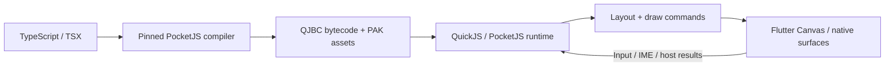

# Pocket

**Build TypeScript apps, games, and visual novels. Run them as QuickJS bytecode inside Flutter, with a shared PocketJS toolchain for Web and Preview.**

**English** · [简体中文](README.zh-CN.md)

Pocket combines a JS-owned application layer with a thin native host. Write UI, state, routing, and interactions in TypeScript/TSX; the pinned PocketJS engine handles layout and draw commands, while Flutter supplies Canvas rendering, system text input, lifecycle, resource decoding, and explicitly registered native capabilities.

[Get started](#get-started) · [Features](#features) · [Measured results](#measured-results) · [Platform status](#platform-status) · [Documentation](#documentation)

## Why Pocket

- **One application layer in TypeScript.** Solid reactivity, reusable UI, navigation, mini-app composition, and game logic share the same JS runtime model.
- **Real precompiled guests.** Build `app.qjbc` and `app.pak` with one pinned compiler. Runtime admission checks bytecode format and ABI; production does not fall back to evaluating application source.
- **Embed or ship a complete shell.** Use `PocketGuest` inside an existing Flutter screen, `PocketApp` for a standalone app, or the SystemUI runtime for multiple mini-apps.
- **Build, preview, and publish together.** Pocket Studio brings source/assets, real guest Preview, device deployment, signed updates, and version inspection into one local workflow.
- **Reuse the same pipeline across targets.** Flutter, native Preview, standalone Web/WASM, and the WeChat adapter build from the pinned PocketJS implementation. Their host capabilities and validation coverage differ; see the platform table below.

## Features

| Area | Current capabilities |
| --- | --- |
| **UI and design systems** | `@pocket/ui` layouts, mobile scaffolds, themes, controls, forms, lists, dialogs, scrolling, and navigation transitions. `@pocket/looseleaf` adds paper, marker, felt-tip, and tape styling; `@pocket/arc` adds semantic tokens and calm motion. |
| **Text and input** | Host-native font integration, inline text, wrapping, selection/composing-aware system IME, input overlays, and keyboard-aware scrolling. |
| **Adaptive layouts** | Viewport, safe-area, keyboard, and available display-pane geometry, including Duo/foldable adaptation where platform geometry is available. |
| **Rendering** | Typed PFB1 binary frames, unchanged/delta frame handling, retained draw chunks, bounded text/image caches, gradients, rounded shapes, textured triangles, and managed surfaces. |
| **Scheduling** | Fixed guest ticks with monotonic host time; known-idle pages stop ticking, timers use deadline wakeups, and input/messages resume work. Active animation keeps running. |
| **Communication** | Structured HostBridge requests/responses, bounded event streams, and ABI v2 lock-free SPSC numeric queues with 16-byte records and batching. |
| **Mini-apps and SystemUI** | JS-owned catalogs, navigation stacks, cross-app messages/results, presentation, on-demand loading, prewarming, eviction policy, and per-app storage. |
| **Runtime limits** | Manifest capability/permission negotiation, host allowlists, execution budgets, per-realm QuickJS heap limits, and PAK admission limits. |
| **Resources and utilities** | PAK packaging and resource revision tracking, native ZIP/7z extraction with output quotas/path checks on supported Apple/Android hosts, and JS UTF-8/Base64 helpers in `@pocket/ui/bytes`. |
| **Workers and networking** | Official JS business Workers and Worker HTTP; optional Dio HTTP with request/response decoding in a dedicated IO isolate and explicit allowed origins. |
| **Hardware and platform** | Optional camera/photos, BLE GATT and notifications, sensors, location/weather, biometrics, permissions, system bars, haptics, and opt-in deep links. `@pocket/tftc` supplies device-control/feedback clients. |
| **Media and models** | Audio, managed local-video surfaces, Spine and Live2D integration, plus Web/Preview adapters with documented support boundaries. |
| **Signed updates** | Ed25519 manifests, SHA-256 content checks, ABI/host compatibility, content-addressed resource caching, anti-replay/downgrade checks, health-gated activation, and verified rollback. |
| **Recording and diagnostics** | Opt-in bounded recording, export/import and offline replay of captured runtime transactions, frame checks, per-app diagnostics, Flutter frame timing, and separate Guest tick metrics. |
| **Developer tools** | App/Game scaffolds, npm-managed platform tools, CLI, Studio, project/channel releases, SDK upgrade UI, asset editing, logs, and preview links for browser/AI workflows. |
| **Distribution** | Platform-specific macOS arm64 and Windows x64 SDK archives, checksums and consumer acceptance reports; standalone Web export uses the same guest build pipeline. |

The core SDK keeps optional hardware and networking packages separate. Native plugins are compiled into the trusted host; a guest update can request registered capabilities but cannot install native code.

### Visual novels

`@pocket/vn` adds a JS-owned narrative engine and authoring workflow:

- Typed dialogue, choices, conditions, branching, calls/returns, variables, and player input.
- Saves, slots/thumbnails, load validation, rollback, backlog, auto/skip, and persistent unlock progress.
- Scene objects, background layers, camera and timeline authoring, transitions, rich text, and responsive presentation.
- Audio/voice bindings, localization catalogs, collections, inventory, CG gallery, and scene replay.
- Spine/Live2D stage integration and model preview tools.
- Studio script/graph editing, variable/resource tools, contextual preview, debug controls, draft/history, and project backup/restore.

The Showcase story **《雾港末班信》** exercises the same public SDK. See the [visual novel guide](sdk/docs/VISUAL_NOVEL_ENGINE.md), [editor](sdk/docs/VISUAL_NOVEL_EDITOR.md), and [remaining feature gaps](sdk/docs/VISUAL_NOVEL_LETSGAL_PARITY.md) for the exact scope.

## How it works



JS owns application state and composition. Flutter does not create a business Widget for every JS control. The engine projects the guest tree into draw commands; Flutter renders them and bridges the necessary platform boundaries.

QuickJS bytecode is VM bytecode, **not ARM machine code**. PFB1 reduces text serialization for frame geometry/resources, but still requires safe buffer copying and decoding. The lock-free guarantee applies to the SPSC queue data path, not the complete runtime or renderer. See [architecture](sdk/docs/OVERVIEW.md), [frame transport](sdk/docs/BINARY_BRIDGE_PROTOCOL.md), and [duplex ownership](sdk/docs/DUPLEX_TRANSPORT.md).

## Measured results

These are recorded experiments and regression snapshots, not cross-device performance guarantees. Each source includes the workload and validation limits.

| Evidence | Recorded result | Environment and scope |
| --- | --- | --- |
| **Android clip optimization** | Raster median **56.451 → 3.084 ms**; p95 **61.226 → 3.978 ms**. Baseline/fixed samples: 154/483 frames. | MAA_AN00 / SM7550, Flutter 3.35.7, Impeller Vulkan, same Showcase scene in Profile. Rectangular clips retained; only clip-edge AA changed. [Ablation report](sdk/docs/ANDROID_IMPELLER_SCISSOR.md). |
| **Android Release presentation** | SurfaceFlinger interval median **16.707 ms**, p90 **16.709 ms**, 98 valid intervals. | Same device, Release build after the clip fix. Presentation intervals are a different metric from Profile raster time. [Device acceptance](sdk/docs/ANDROID_IMPELLER_SCISSOR.md#release-真机验收结果). |
| **Deadline scheduling** | **300 → 1** observation callbacks before a 5-second deadline; both paths fire at virtual frame 300 and update text. | Same real JSX → QJBC/PAK → native probe fixture, continuous versus demand scheduling. This measures avoided work, not battery savings. [Scheduler validation](sdk/docs/GLYPH_AND_SCHEDULER_IMPLEMENTATION.md). |
| **Offline replay** | **402 transactions / 145 frames** matched after destroying the original session. | Recorded keyboard/input/viewport/host scenarios, then offline replay; not GPU or physical-keyboard timing replay. [Replay evidence](sdk/docs/PERFORMANCE.md). |
| **Flutter 3.50 upgrade** | **620 tests passed** across `pocket_flutter` (277), services (89), SDK (200), and Showcase (54); SDK additionally skipped 10 fixture-dependent tests. | 2026-11-13 local upgrade snapshot. macOS debug build, real pointer-driven pixel change, and model Showcase drive also passed. These are test counts, not a performance benchmark. [Upgrade report](sdk/docs/FLUTTER_3_50_UPGRADE.md). |
| **New UI packages** | Pointer-driven **Count 0 → 1 → 11**, with changed native DrawOps. | Looseleaf and ARC compiled through the same pinned guest pipeline and executed in the native probe. [Integration evidence](sdk/docs/LOCAL_WORK_CONFLICT_RESOLUTION_20261113.md). |

Flutter FPS and Guest ticks/s are separate measurements. Known-idle pages can stop the guest ticker; there is no published device power measurement or fixed energy-saving percentage. Historical Flutter 3.35.7 numbers above have **not** been relabeled as Flutter 3.50 benchmarks.

## Get started

### Use a packaged SDK

For application development, use the matching **macOS arm64** or **Windows x64** SDK archive from [GitHub Releases](https://github.com/CodeEagle/pocket/releases). Platform tool packages are shipped with the SDK archives rather than published to the npm registry. Use Node.js **22.22.2+** and npm. Flutter deployment additionally needs Flutter and the target platform toolchain.

From the extracted SDK root:

```sh
npm run setup
npm run doctor
npm run editor
```

Open **http://127.0.0.1:8791**. Studio can create App/Game projects, build actual QJBC/PAK, and run interactive Preview. The packaged toolchain supplies Bun and the native compiler/probe; this path does not require a global Bun, Rust, Python, or C++ installation for guest builds.

Create an independent Flutter consumer from the SDK root:

```sh
npm run init -- /absolute/path/to/my-app --template=app --sdk-root .
npm run build -- /absolute/path/to/my-app --sdk-root . --platform=ios-sim
cd /absolute/path/to/my-app/flutter
flutter pub get
flutter devices
flutter run -d DEVICE_ID
```

Replace `DEVICE_ID` with a value from `flutter devices`. The example targets an Apple Silicon iOS simulator on macOS. Flutter/native builds need the corresponding Xcode, Android SDK/NDK, or native build tools. Choose `--template=game` for the game starter; hardware, Dio, platform experience, and deep links are explicit options. See [templates](sdk/docs/PROJECT_TEMPLATES.md) and [integration](sdk/docs/SDK_INTEGRATION.md).

### Develop this repository

The repository has two entry points: [`sdk/`](sdk/README.md) is the reusable implementation; [`demo/`](demo/README.md) is its Showcase consumer, with all application JS under `demo/js/`.

The project pins **Flutter 3.50.0 / Dart 3.14.0** in [`.fvmrc`](.fvmrc). Public Flutter package constraints remain Flutter ≥3.35.0 / Dart ^3.9.2. Source builds additionally require Bun, Python 3, `patch`, Rust/Cargo ≥1.93, and the platform C/C++ toolchain. Release CI pins Rust 1.98.1.

Some Showcase assets require separate preparation: Lantern bytecode/assets and the official Live2D Cubism Core are not committed binaries. Follow the [Showcase guide](demo/README.md) and [local acceptance record](sdk/docs/FLUTTER_3_50_UPGRADE.md#本机-showcase-补验2026-11-13); the Core bootstrap requires accepting Live2D's terms. For iOS/Android native targets, use the [integration guide](sdk/docs/SDK_INTEGRATION.md).

For an Apple Silicon macOS source checkout, prepare and run the Showcase using the retained source workflow:

```sh
cd sdk
export POCKET_SOURCE_BUILD=1
bun install --frozen-lockfile
python3 scripts/prepare_upstream.py
bash scripts/build_native.sh macos
cd ../demo/js
bun install --frozen-lockfile
bun run build:system
cd ..
flutter pub get
flutter run -d macos
```

Once a matching prebuilt tool package is installed, repository-root `npm start`, `npm run status`, and `npm stop` manage Studio bound to the Showcase. A source checkout without that package must use the documented [source/toolchain setup](sdk/docs/NPM_TOOLCHAIN.md); it does not silently fall back to compiling missing tools.

Changes to Rust or the native ABI require rebuilding the target native library and Flutter app. Flutter hot reload does not compile Rust. Generated caches and binaries are rebuildable outputs, not source dependencies to commit.

## Platform status

| Target | Current implementation and evidence | Boundary |
| --- | --- | --- |
| **iOS** | arm64 device and Apple Silicon simulator host; system input, native capabilities, and documented interaction regressions. | iOS 15+; Xcode/SwiftPM. No Intel simulator slice. Hardware and newer display geometry require target-specific validation. |
| **Android** | arm64-v8a host; physical-device Impeller Profile/Release evidence above. | API 24+ and SDK/NDK. Hardware/plugin support depends on device and authorization. |
| **macOS** | arm64 host; Flutter 3.50 build and real model Showcase execution passed locally. | Declared minimum macOS 12; recent local acceptance ran on macOS 27.2, not every older OS. |
| **Windows tools / Studio** | x64 prebuilt compiler/probe, Noble addon, clean-consumer guest builds and Preview/Studio lifecycle have historical Windows CI acceptance. | This is toolchain acceptance, not Flutter desktop or BLE-device acceptance. [Windows build evidence](sdk/docs/WINDOWS_BUILD.md). |
| **Windows Flutter** | Runner, FFI DLL loader, native build script, and audio backend exist in source. | Current release workflow does not validate the Flutter runner; GUI/runtime acceptance remains separate. [Host status](sdk/docs/WINDOWS_FLUTTER.md). |
| **Web / WASM** | Standalone SDK export and real QJBC execution; recorded Chromium input-driven frame changes. | Browser rendering/media/hardware differ from Flutter; a native Preview pass is not a WASM pass. [Web SDK](sdk/docs/WEB_SDK_EXPORT.md). |
| **WeChat Mini Program** | Generated single-guest WASM adapter; real QJBC pointer/pixel/storage/cleanup tested in Node WebAssembly. | No WeChat DevTools/device acceptance; no SystemUI multi-app composition or business Worker/HTTP wiring. [Adapter scope](sdk/docs/WECHAT_HOST_IMPLEMENTATION.md). |
| **Linux** | Source/toolchain adaptation work exists. | No equivalent validated platform SDK distribution or Flutter-host acceptance claimed. |

## Signed delivery and trust

Updates bind the guest identity, bytecode, and resources through a signed manifest. The host checks Ed25519 signatures, SHA-256/size, runtime ABI, compatibility, and release identity before activation. Candidates pass a first-frame/health window before promotion; failures can return to verified previous/last-good or bundled content.

Permissions combine **host policy → guest declarations → operating-system authorization**. Per-realm heap budgets do not cap total process RSS, decoded textures, GPU memory, or all Workers combined. Studio is a local development service, not an untrusted multi-tenant code sandbox.

See [release trust](sdk/docs/RELEASE_TRUST_POLICY.md), [updates](sdk/docs/PACKAGE_UPDATE_MODES.md), [memory limits](sdk/docs/APP_MEMORY_LIMITS.md), and [guest security](sdk/docs/GUEST_SECURITY.md).

## Documentation

| Start here | Guides |
| --- | --- |
| Build an app | [AI application guide](sdk/docs/AI_APP_DEVELOPMENT.md) · [Integration](sdk/docs/SDK_INTEGRATION.md) · [App/Game templates](sdk/docs/PROJECT_TEMPLATES.md) |
| UI and input | [Components](sdk/docs/COMPONENTS.md) · [System IME](sdk/docs/INPUT_REUSE.md) · [Text layout](sdk/docs/INLINE_TEXT_IMPLEMENTATION.md) · [Display adaptation](sdk/docs/DUO_ADAPTATION.md) |
| Mini-apps | [System compositor](sdk/docs/SYSTEM_COMPOSITOR_IMPLEMENTATION.md) · [On-demand apps](sdk/docs/ON_DEMAND_MINI_APPS.md) · [Before-open updates](sdk/docs/MINI_APP_UPDATE_BEFORE_OPEN.md) |
| Native capabilities | [Optional packages](sdk/docs/OPTIONAL_PLUGINS.md) · [Hardware modules](sdk/docs/HARDWARE_MODULES.md) · [Dio Worker](sdk/docs/DIO_WORKER.md) · [TFTC](sdk/packages/pocket_tftc/README.md) · [Archive extraction](sdk/packages/pocket_archive/README.md) |
| Studio and publishing | [Studio](sdk/docs/EDITOR_STUDIO.md) · [npm toolchain](sdk/docs/NPM_TOOLCHAIN.md) · [Version backend](sdk/docs/EDITOR_VERSION_BACKEND.md) · [Web export](sdk/docs/WEB_SDK_EXPORT.md) |
| Visual novels | [Feature tour](sdk/docs/VISUAL_NOVEL_FEATURE_TOUR.md) · [Engine](sdk/docs/VISUAL_NOVEL_ENGINE.md) · [Editor](sdk/docs/VISUAL_NOVEL_EDITOR.md) · [Platform coverage](sdk/docs/VISUAL_NOVEL_PLATFORMS.md) |
| Performance and debugging | [Performance](sdk/docs/PERFORMANCE.md) · [Flutter FPS](sdk/docs/FLUTTER_FPS.md) · [Recording/replay](sdk/docs/RECORDING_REPLAY.md) · [Diagnostics](sdk/docs/DIAGNOSTICS_PACKAGE.md) |
| Architecture and provenance | [Overview](sdk/docs/OVERVIEW.md) · [Framework](sdk/docs/FRAMEWORK_GUIDE.md) · [Pinned upstream](sdk/docs/PROVENANCE.md) · [Validation](sdk/docs/VALIDATION.md) |

PocketJS upstream is pinned to `99924de47c62fa36f526a8791055d91cbbdb3836`; the bootstrap verifies the archive SHA-256 and applies controlled patches. Lockfiles and [`prepare_upstream.py`](sdk/scripts/prepare_upstream.py) define the reproducible build inputs. SDK code does not import Showcase internals.

## License

Pocket is [MIT licensed](LICENSE). Third-party engines, dependencies, fonts, models, and artwork retain their own licenses. Live2D Cubism Core is obtained separately under its applicable terms; see the [Studio notices](sdk/editor/NOTICE.md).
