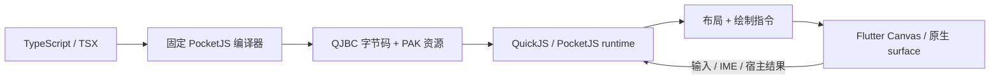

# Pocket

**用 TypeScript 开发应用、游戏和视觉小说，以 QuickJS 字节码运行在 Flutter 中，并与 Web、Preview 共用 PocketJS 工具链。**

[English](README.md) · **简体中文**

Pocket 将 JS 应用层与薄原生宿主结合：使用 TypeScript/TSX 编写 UI、状态、路由和交互，由固定版本的 PocketJS 引擎负责布局和绘制指令；Flutter 提供 Canvas 绘制、系统文本输入、生命周期、资源解码和显式注册的原生能力。

[快速开始](#快速开始) · [功能特点](#功能特点) · [实测与验证数据](#实测与验证数据) · [平台状态](#平台状态) · [文档导航](#文档导航)

## 为什么选择 Pocket

- **用 TypeScript 统一应用逻辑。** Solid 响应式、可复用 UI、导航、微应用组合与游戏逻辑共用同一 JS 运行模型。
- **运行真实预编译产物。** 固定编译器生成 `app.qjbc` 和 `app.pak`；加载时校验字节码格式与 ABI，生产运行不回退到应用源码解释执行。
- **既可嵌入，也可独立成壳。** 通过 `PocketGuest` 嵌入现有 Flutter 页面，通过 `PocketApp` 构建独立应用，或使用 SystemUI 组织多个微应用。
- **开发、预览与发布连成闭环。** Pocket Studio 集中提供源码/资源编辑、真实 Guest Preview、设备部署、签名更新和版本检查。
- **多个目标复用同一管线。** Flutter、原生 Preview、独立 Web/WASM 和微信适配器共用固定 PocketJS 实现；各宿主的能力与验收范围见下方平台表。

## 功能特点

| 领域 | 当前能力 |
| --- | --- |
| **UI 与设计系统** | `@pocket/ui` 提供布局、移动 Scaffold、主题、控件、表单、列表、对话框、滚动和导航转场；`@pocket/looseleaf` 提供纸张、马克笔、毡头笔与胶带风格；`@pocket/arc` 提供语义 Token 与柔和动效。 |
| **文字与输入** | 宿主原生字体接入、行内文字、自动换行、保留选区/composing 的系统 IME、输入覆盖层及键盘感知滚动。 |
| **自适应布局** | 视口、安全区、键盘和可用显示分区几何；平台能提供相应信息时支持 Duo/折叠屏适配。 |
| **绘制与缓存** | PFB1 类型化二进制帧、unchanged/delta 帧处理、保留绘制分块、有界文字/图片缓存、渐变、圆角、纹理三角形与受控 surface。 |
| **按需调度** | 固定 Guest tick 与单调宿主时间；已知空闲页面停止 ticker，定时器按 deadline 唤醒，输入/消息恢复执行；活动动画持续推进。 |
| **双向通讯** | 结构化 HostBridge 请求/响应、有界事件流，以及 ABI v2 lock-free SPSC 数值队列；每条记录 16 字节，支持批处理。 |
| **微应用与 SystemUI** | JS 持有 catalog、导航栈、跨应用消息/返回结果、呈现方式、按需加载、预热、淘汰策略和按应用隔离的存储。 |
| **运行预算** | Manifest 能力/权限协商、宿主允许范围、执行预算、每个 realm 的 QuickJS 堆限制和 PAK 准入限制。 |
| **资源与工具** | PAK 打包与资源 revision 跟踪；在支持的 Apple/Android 宿主上提供带输出配额/路径检查的原生 ZIP/7z 解压；`@pocket/ui/bytes` 提供 JS UTF-8/Base64 工具。 |
| **Worker 与网络** | 官方 JS 业务 Worker、Worker HTTP；可选 Dio 在独立 IO isolate 中处理请求与响应解码，要求显式配置可信 origin。 |
| **硬件与系统能力** | 可选相机/照片、BLE GATT 与通知、传感器、定位/天气、生物识别、权限、系统栏、触觉和按需开启的深链；`@pocket/tftc` 提供设备控制与反馈客户端。 |
| **媒体与模型** | 音频、受控本地视频 surface、Spine 与 Live2D 接入，以及有明确支持边界的 Web/Preview 适配。 |
| **签名热更新** | Ed25519 manifest、SHA-256 内容校验、ABI/宿主兼容检查、内容寻址资源缓存、防重放/降级、健康窗口晋升与已验证版本回退。 |
| **录制与诊断** | 按需开启的有界录制、导出/导入和已捕获运行事务的离线回放、帧一致性检查、按应用诊断、Flutter 帧时序与独立 Guest tick 指标。 |
| **开发工具** | App/Game 脚手架、npm 管理的平台工具、CLI、Studio、项目/频道发布、SDK 升级 UI、资源编辑、日志及适合浏览器/AI 工作流的预览链接。 |
| **分发** | macOS arm64、Windows x64 分平台 SDK 归档、校验和与消费者验收报告；独立 Web 导出沿用相同 Guest 构建管线。 |

核心 SDK 与可选硬件、网络包分离。原生插件由可信宿主编译注册；Guest 更新可以申请已注册的能力，不能安装原生代码。

### 视觉小说

`@pocket/vn` 提供由 JS 持有的叙事引擎与创作流程：

- 类型化对白、选项、条件、分支、调用/返回、变量与玩家输入。
- 存档、槽位/缩略图、读档校验、回滚、历史记录、自动/快进及持久解锁进度。
- 场景对象、背景分层、镜头和时间线编排、转场、富文本与响应式呈现。
- 音频/配音绑定、本地化目录、收集项、物品栏、CG 鉴赏和场景回放。
- Spine/Live2D 舞台接入与模型预览工具。
- Studio 剧本/图编辑、变量/资源工具、上下文预览、调试控制、草稿/历史与项目备份恢复。

Showcase 故事 **《雾港末班信》** 使用同一套公共 SDK。准确范围见[视觉小说引擎](sdk/docs/VISUAL_NOVEL_ENGINE.md)、[编辑器](sdk/docs/VISUAL_NOVEL_EDITOR.md)与[尚未完成的能力](sdk/docs/VISUAL_NOVEL_LETSGAL_PARITY.md)。

## 工作原理



JS 持有应用状态与组件组合。Flutter 不为每个 JS 控件创建业务 Widget：引擎将 Guest 节点树投影为绘制指令，Flutter 负责呈现并承接必要的平台边界。

QuickJS 产物是 **VM 字节码，不是 ARM 机器码**。PFB1 减少帧几何/资源的文本序列化，但仍需要安全复制和解码；lock-free 只描述 SPSC 队列数据路径，不描述整个 runtime 或 renderer。详见[架构](sdk/docs/OVERVIEW.md)、[帧传输](sdk/docs/BINARY_BRIDGE_PROTOCOL.md)和[双向通道所有权](sdk/docs/DUPLEX_TRANSPORT.md)。

## 实测与验证数据

以下为已有实验与回归快照，不是跨设备性能保证。来源文档保留了负载、环境与验收边界。

| 证据 | 已记录结果 | 环境与范围 |
| --- | --- | --- |
| **Android 裁剪优化** | Raster median **56.451 → 3.084 ms**；p95 **61.226 → 3.978 ms**。基线/修复采样分别为 154/483 帧。 | MAA_AN00 / SM7550，Flutter 3.35.7，Impeller Vulkan，同一 Showcase 场景的 Profile 采样。保留矩形 clip，只调整 clip 边缘抗锯齿。[消融记录](sdk/docs/ANDROID_IMPELLER_SCISSOR.md)。 |
| **Android Release 呈现** | SurfaceFlinger 帧间隔 median **16.707 ms**、p90 **16.709 ms**，98 个有效间隔。 | 同一设备修复后的 Release 构建。系统呈现间隔与 Profile raster 耗时是不同指标。[真机验收](sdk/docs/ANDROID_IMPELLER_SCISSOR.md#release-真机验收结果)。 |
| **Deadline 调度** | 5 秒截止前的观察回调 **300 → 1**；两条路径均在虚拟第 300 帧触发并更新文字。 | 相同真实 JSX → QJBC/PAK → native probe 场景，对比连续与按需调度。衡量减少的工作，不是省电百分比。[调度验证](sdk/docs/GLYPH_AND_SCHEDULER_IMPLEMENTATION.md)。 |
| **离线回放** | 原实例销毁后，**402 条事务 / 145 帧**全部匹配。 | 录制键盘/输入/视口/宿主场景，再离线回放；不重放 GPU 或实体键盘的耗时。[回放证据](sdk/docs/PERFORMANCE.md)。 |
| **Flutter 3.50 升级** | **620 项测试通过**：`pocket_flutter` 277、services 89、SDK 200、Showcase 54；SDK 另有 10 项依赖额外 fixture 的测试跳过。 | 2026-11-13 本机升级快照；macOS debug 构建、真实指针驱动像素变化和模型 Showcase drive 也通过。这里是测试数量，不是性能基准。[升级报告](sdk/docs/FLUTTER_3_50_UPGRADE.md)。 |
| **新 UI 包** | 真实指针驱动 **Count 0 → 1 → 11**，native DrawOps 随之变化。 | Looseleaf 与 ARC 通过同一固定 Guest 管线编译并在 native probe 中执行。[集成证据](sdk/docs/LOCAL_WORK_CONFLICT_RESOLUTION_20261113.md)。 |

Flutter FPS 与 Guest ticks/s 分开统计。已知空闲页可以停表；当前没有公开的设备功耗实测或固定省电比例。表中 Flutter 3.35.7 的历史数据保留原始版本，**不冒充 Flutter 3.50 性能结果**。

## 快速开始

### 使用打包 SDK

应用开发可从 [GitHub Releases](https://github.com/CodeEagle/pocket/releases) 获取对应 **macOS arm64** 或 **Windows x64** 的 SDK 归档。平台工具随 SDK 归档分发，不发布到 npm registry。需要 Node.js **22.22.2+** 与 npm；部署 Flutter 应用还需 Flutter 和目标平台工具链。

在解压后的 SDK 根目录执行：

```sh
npm run setup
npm run doctor
npm run editor
```

打开 **http://127.0.0.1:8791**。Studio 可以创建 App/Game 项目、构建真实 QJBC/PAK 并运行交互 Preview。打包工具链提供 Bun 和原生编译器/probe；此路径的 Guest 构建不需要全局 Bun、Rust、Python 或 C++ 环境。

在 SDK 根目录创建独立 Flutter 消费工程：

```sh
npm run init -- /absolute/path/to/my-app --template=app --sdk-root .
npm run build -- /absolute/path/to/my-app --sdk-root . --platform=ios-sim
cd /absolute/path/to/my-app/flutter
flutter pub get
flutter devices
flutter run -d DEVICE_ID
```

将 `DEVICE_ID` 替换为 `flutter devices` 列出的设备 ID。上例用于 macOS 上的 Apple Silicon iOS 模拟器。Flutter/原生构建需要对应的 Xcode、Android SDK/NDK 或原生构建工具。游戏起点使用 `--template=game`；硬件、Dio、系统体验和深链均按需显式开启。见[模板](sdk/docs/PROJECT_TEMPLATES.md)与[集成指南](sdk/docs/SDK_INTEGRATION.md)。

### 开发本仓库

仓库只有两个入口：[`sdk/`](sdk/README.md) 是可复用实现；[`demo/`](demo/README.md) 是 Showcase 消费者，全部业务 JS 位于 `demo/js/`。

[`.fvmrc`](.fvmrc) 固定 **Flutter 3.50.0 / Dart 3.14.0**。公共 Flutter 包约束仍为 Flutter ≥3.35.0 / Dart ^3.9.2。源码构建还需要 Bun、Python 3、`patch`、Rust/Cargo ≥1.93 与平台 C/C++ 工具链；Release CI 固定 Rust 1.98.1。

部分 Showcase 资源需要单独准备：Lantern 字节码/资源与官方 Live2D Cubism Core 不作为二进制提交。请先按 [Showcase 指南](demo/README.md)和[本机验收记录](sdk/docs/FLUTTER_3_50_UPGRADE.md#本机-showcase-补验2026-11-13)准备；Core bootstrap 要求接受 Live2D 条款。iOS/Android 原生目标见[集成指南](sdk/docs/SDK_INTEGRATION.md)。

Apple Silicon macOS 源码工作区可沿用现有流程准备并运行 Showcase：

```sh
cd sdk
export POCKET_SOURCE_BUILD=1
bun install --frozen-lockfile
python3 scripts/prepare_upstream.py
bash scripts/build_native.sh macos
cd ../demo/js
bun install --frozen-lockfile
bun run build:system
cd ..
flutter pub get
flutter run -d macos
```

安装匹配的预编译工具包后，在仓库根目录通过 `npm start`、`npm run status` 和 `npm stop` 管理绑定 Showcase 的 Studio。缺少该包的源码工作区需按[源码/工具链说明](sdk/docs/NPM_TOOLCHAIN.md)准备，不会静默回退到本机编译缺失工具。

Rust 或原生 ABI 改动需要重建目标原生库和 Flutter 应用；Flutter hot reload 不编译 Rust。缓存与二进制均为可重建产物，不应作为源码提交。

## 平台状态

| 目标 | 当前实现与证据 | 边界 |
| --- | --- | --- |
| **iOS** | arm64 真机与 Apple Silicon 模拟器宿主；系统输入、原生能力及已记录的交互回归。 | iOS 15+，Xcode/SwiftPM；不提供 Intel 模拟器 slice。硬件与新显示几何仍需目标平台验证。 |
| **Android** | arm64-v8a 宿主；有上表 Impeller Profile/Release 真机数据。 | API 24+，SDK/NDK；硬件/插件能力取决于设备与授权。 |
| **macOS** | arm64 宿主；本机 Flutter 3.50 构建与真实模型 Showcase 执行通过。 | 声明最低 macOS 12；近期本机验收在 macOS 27.2，未逐一验证旧系统。 |
| **Windows 工具 / Studio** | x64 预编译 compiler/probe、Noble addon、干净消费者 Guest 构建及 Preview/Studio 生命周期有历史 Windows CI 验收。 | 工具链验收不等于 Flutter 桌面或 BLE 设备验收。[Windows 构建证据](sdk/docs/WINDOWS_BUILD.md)。 |
| **Windows Flutter** | 源码已有 runner、FFI DLL loader、原生构建脚本和音频后端。 | 当前发布流程未验证 Flutter runner；GUI/运行期需单独验收。[宿主状态](sdk/docs/WINDOWS_FLUTTER.md)。 |
| **Web / WASM** | 独立 SDK 导出与真实 QJBC 执行；有 Chromium 输入驱动画面变化记录。 | 浏览器渲染/媒体/硬件与 Flutter 不同；原生 Preview 通过不代表 WASM 通过。[Web SDK](sdk/docs/WEB_SDK_EXPORT.md)。 |
| **微信小程序** | 生成单 Guest WASM 适配器；在 Node WebAssembly 验证真实 QJBC 指针/像素/存储/清理。 | 未完成微信开发者工具/真机验收；不支持 SystemUI 多应用组合或业务 Worker/HTTP 接线。[适配范围](sdk/docs/WECHAT_HOST_IMPLEMENTATION.md)。 |
| **Linux** | 已有源码/工具链适配工作。 | 不宣称已有同等验收的平台 SDK 分发或 Flutter 宿主。 |

## 签名交付与信任边界

更新通过签名 manifest 绑定 Guest 身份、字节码和资源。宿主在激活前校验 Ed25519 签名、SHA-256/大小、runtime ABI、兼容性和发布身份；候选经过首帧/健康窗口后才晋升，失败时可以恢复已验证的 previous/last-good 或内置内容。

权限依次经过 **宿主策略 → Guest 声明 → 操作系统授权**。单 realm 堆预算不等于进程 RSS、解码纹理、GPU 或全部 Worker 的总内存上限。Studio 面向本地开发，不是不可信多租户代码沙箱。

详见[发布信任](sdk/docs/RELEASE_TRUST_POLICY.md)、[更新模式](sdk/docs/PACKAGE_UPDATE_MODES.md)、[内存限制](sdk/docs/APP_MEMORY_LIMITS.md)与[Guest 安全](sdk/docs/GUEST_SECURITY.md)。

## 文档导航

| 从这里开始 | 指南 |
| --- | --- |
| 开发应用 | [AI 应用开发](sdk/docs/AI_APP_DEVELOPMENT.md) · [集成](sdk/docs/SDK_INTEGRATION.md) · [App/Game 模板](sdk/docs/PROJECT_TEMPLATES.md) |
| UI 与输入 | [组件](sdk/docs/COMPONENTS.md) · [系统 IME](sdk/docs/INPUT_REUSE.md) · [文字布局](sdk/docs/INLINE_TEXT_IMPLEMENTATION.md) · [显示适配](sdk/docs/DUO_ADAPTATION.md) |
| 微应用 | [系统合成器](sdk/docs/SYSTEM_COMPOSITOR_IMPLEMENTATION.md) · [按需应用](sdk/docs/ON_DEMAND_MINI_APPS.md) · [打开前更新](sdk/docs/MINI_APP_UPDATE_BEFORE_OPEN.md) |
| 原生能力 | [可选包](sdk/docs/OPTIONAL_PLUGINS.md) · [硬件模块](sdk/docs/HARDWARE_MODULES.md) · [Dio Worker](sdk/docs/DIO_WORKER.md) · [TFTC](sdk/packages/pocket_tftc/README.md) · [原生解压](sdk/packages/pocket_archive/README.md) |
| Studio 与发布 | [Studio](sdk/docs/EDITOR_STUDIO.md) · [npm 工具链](sdk/docs/NPM_TOOLCHAIN.md) · [版本后端](sdk/docs/EDITOR_VERSION_BACKEND.md) · [Web 导出](sdk/docs/WEB_SDK_EXPORT.md) |
| 视觉小说 | [功能导览](sdk/docs/VISUAL_NOVEL_FEATURE_TOUR.md) · [引擎](sdk/docs/VISUAL_NOVEL_ENGINE.md) · [编辑器](sdk/docs/VISUAL_NOVEL_EDITOR.md) · [平台覆盖](sdk/docs/VISUAL_NOVEL_PLATFORMS.md) |
| 性能与调试 | [性能](sdk/docs/PERFORMANCE.md) · [Flutter FPS](sdk/docs/FLUTTER_FPS.md) · [录制回放](sdk/docs/RECORDING_REPLAY.md) · [诊断](sdk/docs/DIAGNOSTICS_PACKAGE.md) |
| 架构与来源 | [总览](sdk/docs/OVERVIEW.md) · [框架](sdk/docs/FRAMEWORK_GUIDE.md) · [固定上游](sdk/docs/PROVENANCE.md) · [验收](sdk/docs/VALIDATION.md) |

PocketJS 上游固定为 `99924de47c62fa36f526a8791055d91cbbdb3836`；bootstrap 校验归档 SHA-256 并应用受控补丁。锁文件与 [`prepare_upstream.py`](sdk/scripts/prepare_upstream.py) 定义可复现构建输入。SDK 不导入 Showcase 内部实现。

## 许可证

Pocket 使用 [MIT 许可证](LICENSE)。第三方引擎、依赖、字体、模型和美术资源保留各自许可证。Live2D Cubism Core 按适用条款单独获取；另见 [Studio 第三方声明](sdk/editor/NOTICE.md)。
