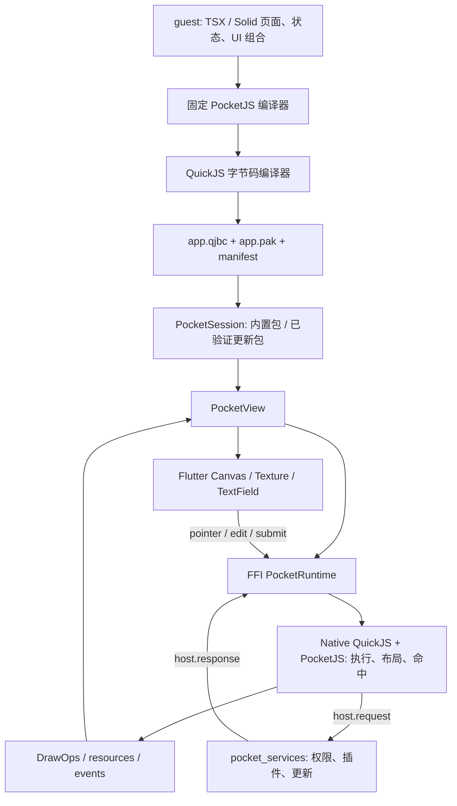

# Pocket Host 源码导览、能力边界与两套 Demo 对照

审计日期：2026-11-02。对象是 `/Volumes/ORICO/Development/Github/pocket/sdk`；`../demo` 是唯一 Showcase 消费者。历史段落中的 `guest/`、`host/`、`packages/pocket_sdk/` 是搬迁前相对路径，当前对应关系见本页目录表和 [`OVERVIEW.md`](OVERVIEW.md)。测试结果引用 [VALIDATION.md](VALIDATION.md) 的已执行记录。

阅读顺序：第 1–2 节看能力结论和调用链；第 3 节查目录/文件；第 4–5 节查验收与支持范围；第 6 节看两个 Demo 的差距；第 7–8 节看下一步整合和修改入口。

## 1. 目前做到哪一步

当前工程已经打通 **JS 编写页面 → QuickJS 预编译字节码 → PocketJS 执行/布局 → Flutter 绘制与系统输入 → 原生插件 → 签名更新与回滚**。它是可运行、可继续扩展的集成框架和能力演示，尚不能称为完整生产框架或两个 Demo 全量迁移版。

最重要的边界：

- 页面、状态、导航和 UI 组合在 JS；Flutter 承担绘制、资源、视口、系统键盘、生命周期和能力调用。Native PocketJS 引擎本身负责布局与命中测试。
- “AOT”在本项目中指 **QuickJS 构建时预编译字节码**，不是原生机器码。正式宿主加载 `app.qjbc`，没有字节码失败后回退 JS 源码的路径。
- “38 个组件”是旧 Demo 的混合清单：20 个上游相关名称、18 个业务组合。真正的原生节点只有 `view/text/image/surface` 四类；DrawList v1 有十类指令。当前不是十类指令、38 个组件全部验收完成。
- macOS 与 iPhone Duo iOS 模拟器有真实链路验证；本轮加入了编译进宿主的 iOS hardware provider，其真实 MethodChannel 集成测试已在 iPhone Duo 模拟器通过（权限查询、不支持错误和清理）。相机、BLE、定位等真机行为尚未验收；Android、完整输入设备和长期性能仍有缺口。
- 本轮已纳入 JS mobile UI、路由转场、glass/platformTexture surface bridge，以及本地 editor 多文件脚手架。两套 Demo 的复杂滚动、媒体、字体、设备输入与完整回归矩阵仍未全部迁入，剩余示例仍有复用价值。

本文所说“已验证”仅指列出的测试范围；“有代码”不等于当前 Demo 有入口，也不等于所有设备已可用。

## 2. 先看整体调用关系



这不是“Flutter 为每个 JS 组件生成一棵 Dart 业务 Widget 树”。大部分内容最终成为 Canvas 绘制指令；真实系统输入框和视频纹理等需要 Flutter 系统适配。

### 2.1 构建链

1. `scripts/prepare_upstream.py` 下载固定 revision、校验归档摘要并应用六个受控补丁。
2. `scripts/build_guest.ts` 导出的统一 `buildGuest()` 入口使用同一份 PocketJS/Solid 编译工具，把消费者的 JS 入口和 `@pocket/ui` 组合编译成中间 JS 与 PAK 资源；`pocket.ts build`、Editor 和 Demo 的 `js/package.json` 都走这条入口。
3. `native/src/bin/pocketjs_bytecode.rs` 用与运行时匹配的 QuickJS 编译中间 JS，生成带 PJBC 封装的二进制。
4. `../demo/assets/` 接收字节码、资源、字节码元数据和能力清单；其他消费者也可把产物写入自己的 Flutter `assets/`。中间 JS 留在 `../demo/js/.pocket-build/` 等忽略目录。
5. `scripts/build_native.sh` 为目标平台编译 Rust 库，Flutter 插件通过 FFI 使用它。
6. `sdk/editor/server.ts` 复用同一 guest scaffold，提供多文件编辑、真实 qjbc/PAK 构建和签名发布；`sdk/editor/test/editor_live_probe.ts` 是不改 Demo 资产的生产 runner 探针。

### 2.2 启动、帧与点击

`demo/lib/main.dart → sdk/lib/pocket_sdk.dart/PocketApp → PocketSession → PocketView → FfiPocketRuntime → sdk/native/src/lib.rs`。

Native 执行真实 guest，PocketJS 产生布局和 DrawList，Dart 解码为 `PocketFrame`，painter 绘制。Flutter pointer 转换为逻辑坐标送回引擎，JS 的 `onPress`/gesture 改变状态，再产生新帧。计数、导航和压力页不是 Dart 伪造的结果。

### 2.3 系统键盘与滚动

`demo/js/ui/index.tsx 的 InputField → textInput.open/update/close → PocketView 中的 Flutter TextField → textInput.edit/submit/dismiss → JS draft`。

输入框在 JS 测量位置；Flutter 保存编辑会话、selection/composing 并连接系统 IME。只更新位置时不覆盖文本或 composing。外层稳定 key 保留同一个 EditableText；点击外部按完整 down/up 处理，拖动不被当作点击关闭。

`ScrollablePage` 复用官方 viewport/content 双节点、gesture 与 kinetics；滚动偏移由 JS 管理。键盘打开后自动显露输入框；视口 resize 过渡期间，自动尺寸的主画布保持 1:1、左上锚定并裁切旧帧，避免整页先缩小再恢复。固定视口预览和辅助 surface 另有尺寸策略。这里的职责分别是 JS 内容滚动和 Flutter 视口正确性，不能用页面上的延时补丁代替框架处理。

### 2.4 插件与更新

JS 通过 `sdk/packages/pocket_ui/src/host.ts` 发出带 requestId 的 `host.request`；`sdk/lib/src/pocket_session.dart` 转交服务注册表，校验声明能力与宿主授权后调用 handler，将结构化结果送回 JS。SDK 默认接入 `package_info_plus`；Showcase 显式依赖并通过 pluginFactories 注册 `pocket_hardware` 的 `HardwarePlugin`，后者覆盖相机/照片、BLE、传感器、生物识别、位置和天气的结构化请求，并拒绝 unsupported/timeout/late result。`demo/test/hardware_plugin_test.dart` 直接验证公开 provider package，真实 iOS MethodChannel 场景由 Demo 集成测试覆盖。

更新经过检查 manifest、验签、ABI/摘要校验、下载缓存、启动候选包、健康确认、晋升健康版本；失败则恢复可用版本。切包会替换 runtime，并对 renderer/host request 回调做 generation 隔离，丢弃旧会话响应；`PocketSession.onError` 会取消延迟挂载/健康 timer，`dispose` 也会取消 timer，避免旧候选覆盖回退。它不下载或热替换 Flutter 原生插件二进制。

## 3. 当前目录总览

用户只需要记住两个入口：`sdk/` 是可复用实现，`demo/` 是示例。SDK 的公共入口
是 `sdk/lib/pocket_sdk.dart` 与 `sdk/pocket.ts`；Demo 的 Flutter 工程直接位于
`demo/`，Demo 的 JS/TS 工程集中位于 `demo/js/`。下面的旧路径说明用于解释源码
来源和职责，遇到路径冲突时以当前目录表为准。

```text
/Volumes/ORICO/Development/Github/pocket/
├── sdk/
│   ├── lib/                  # package:pocket_sdk 公共 Flutter 入口
│   ├── packages/             # renderer、hardware、services、@pocket/ui
│   ├── native/               # Rust FFI、QuickJS runtime、字节码编译器
│   ├── pocket.ts             # 唯一 init/build/editor CLI
│   ├── scripts/ editor/      # 构建、签包、检查和 Editor 服务
│   └── docs/                 # 接入、来源、验证和性能记录
└── demo/
    ├── lib/ ios/ android/ macos/ assets/  # Flutter host 第一层
    └── js/                   # app.tsx、@pocket/ui 组合、JS 测试和 JS 脚本
```

## 3.1 历史实现职责对照

```text
pocket_host/
├── guest/                         # JS 应用、UI 库、状态和能力客户端
│   └── ui/                        # 兼容导出；基础组合 canonical source 在 packages/pocket_ui
├── editor/                        # Pocket Studio 本地多文件编辑/构建/签包服务与 client
├── host/                          # 可运行的 Flutter 宿主壳
│   ├── lib/                       # 启动、会话、性能历史、插件适配
│   ├── assets/                    # 打包后的 qjbc / PAK / manifest
│   ├── integration_test/          # 运行真实 Flutter + native + guest
│   ├── test/                      # 宿主单元/widget 测试
│   ├── test_driver/               # integration_test 驱动入口
│   └── ios/ macos/ android/       # 平台启动与构建配置
├── packages/
│   ├── pocket_ui/                 # 公开 @pocket/ui JS 组合包与显示几何适配
│   │   └── src/                   # ui/mobile/legacy/responsive/display 公共入口
│   ├── pocket_flutter/            # 可复用 renderer / runtime 适配包
│   │   ├── lib/src/               # 绘制、帧模型、FFI、资源、输入
│   │   ├── test/                  # renderer 与协议回归
│   │   └── ios/ macos/ android/   # native 库链接配置
│   ├── pocket_services/           # 可复用签名更新、能力、插件服务包
│   │   ├── lib/src/
│   │   └── test/
│   ├── pocket_hardware/           # 可复用编译进宿主的硬件 provider 与 iOS plugin
│   │   ├── lib/src/               # HardwarePlugin、能力/权限、MethodChannel adapter
│   │   └── ios/Classes/           # PocketHardwarePlugin 与真实 iOS manager
│   └── pocket_sdk/                # 外部应用使用的 PocketApp/PocketSession facade
│       ├── lib/src/               # config、session、性能历史、package_info adapter
│       └── pubspec.yaml           # 依赖 pocket_flutter/services/hardware
├── native/
│   ├── src/                       # Rust FFI 与字节码协议
│   │   └── bin/                   # 字节码编译器、探针、基准程序
│   └── patches/                   # 固定上游的最小补丁
├── scripts/                       # 准备、编译、签包、更新服务器、检查
│   └── tests/fixtures/            # 签名互操作测试数据
├── tests/                         # JS 状态、真实 native、消融检查
├── docs/                          # 本导览、决策、来源和验证记录
├── AGENTS.md                      # 开发边界、先复用与消融规则
├── package.json                   # Bun 命令入口
├── README.md                      # 启动、更新与验证操作
├── state.md                       # 最近一次工作状态，非长期接口契约
└── LICENSE                        # 本工程许可；上游来源另见 PROVENANCE
```

### 3.1 `guest/`：应用层与 JS UI 库

| 文件 | 做什么 | 修改时注意 |
| --- | --- | --- |
| `app.tsx` | Solid 应用入口，Home/Gallery/Host 分类与 Runtime、Bytecode、Updates、Plugins、Stress、FPS history、Mobile UI、Transitions、Hardware 页面；连接能力响应、输入事件、状态和 220ms JS-owned route transition | 新页面与业务交互优先加在这里；移动组件、硬件和转场页已拆至 `mobile-pages.tsx`，SDK 玻璃 surface 能力不作为 Demo 页面入口，旧能力页仍在此入口 |
| `state.ts` | 路由、计数、draft、能力 loading/error/result、压力节点和性能历史的数据结构与纯 reducer | 业务状态的唯一应用层归属；不要在 Dart 再保存一份路由/计数 |
| `packages/pocket_ui/src/host.ts` | requestId、Promise、响应解析、超时 tick、dispose 的 JS 能力客户端 | 不负责授予权限；宿主必须独立验证权限 |
| `packages/pocket_ui/src/ui.tsx` | `SafeAreaScaffold`（canonical safe-area shell）、Header、Button、Badge、Card、Tabs、List、Modal 等组合；`InputField` 系统输入会话；`ScrollablePage` 手势、测量和滚动；MiniBarChart | `@pocket/ui` 的 canonical source；`SafeAreaScaffold` 只消费显式 `edges`，应用页面、状态和路由仍由 guest 持有 |
| `packages/pocket_ui/src/mobile.tsx` / `guest/mobile-pages.tsx` | `MobileThemeProvider`、`MobileScaffold`（复用 `SafeAreaScaffold`，nested 默认 `safeArea="none"`）、AppBar/Card/ListTile、controls/dialog、系统 `InputField`，以及 mobile/transitions/hardware 页面；`GlassSurface` 和 `PlatformTextureSurface` 只注册 `glass`/`platformTexture`，前者仍是 SDK 能力而非 Demo 页面 | JS 拥有组合和状态；原生 surface provider 只接受这两个 kind，不等于任意 compositor 或任意原生 Widget |
| `packages/pocket_ui/src/legacy.ts` | 纯 JS `computeTransitionDescriptor`（四种转场）和 `buildLiquidGlassRecipe`（SDF/参数/采样） | 是来源适配的数学/描述器，不宣称旧 UIKit 的全部渲染实现已迁入 |
| `packages/pocket_ui/src/display.ts` | `createDisplayGeometry()` 订阅现有 `display.viewport` 事件并返回 Solid signal；串接既有 `globalThis.__pocketEvent`，不新增 transport 或逐帧 polling | 显示数据由 PocketView 发送；旧 host 没有事件时只使用 fallback，不自行猜测 Duo/折叠屏机型 |
| `packages/pocket_ui/src/responsive.ts` | `DisplayGeometry` 解析、`reservedInsets`、`availableDisplayRect`/`availableDisplayPanes`、`displayPane` 和 `deriveResponsiveLayout`；根据 safe area、division/occlusion 选择 narrow/wide、bottom/rail 与 pane | pane/frame 已是 guest canvas 坐标；JS 负责响应式布局，不能把 division 当作全局 safe-area 或在 Flutter 再建一套布局引擎 |
| `guest/ui/index.tsx`、`guest/ui/mobile.tsx`、`guest/components.tsx`、`guest/legacy.ts` | 兼容旧导入路径的 re-export | 实现已在 `packages/pocket_ui`；不要在 guest 目录重复实现第二套组件 |
| `manifest.json` | guest 要求/可选的宿主能力，协议版本 | 当前要求 `text.glyphs.baked`；更新、性能、插件能力为 optional；声明不等于授权 |
| `pocket.json` | PocketJS 编译入口、Solid 框架、应用标识和默认视口等 | 编译配置与宿主运行时动态 resize 是不同层 |
| `release.ts` | 内置 guest 的构建时 release marker，当前固定为 embedded；开发更新脚本通过替换页面标题标示 v1/v2 | 展示标签不是签名、版本准入或健康缓存的依据 |
| `pocket-mark.svg` | 示例图片资源，随编译进入 PAK | SVG 是资源输入，不是 Flutter 网络图片业务逻辑 |

`packages/pocket_ui/src/ui.tsx` 中的 `List` 是业务组合；上游 `VirtualList` 是另一个具有虚拟化语义的组件。当前 Updates/FPS 内容中有内层虚拟列表，外层又可滚动，边缘交接尚待专门设备测试。

### 3.2 `host/`：启动壳与应用级集成

| 文件/目录 | 做什么 |
| --- | --- |
| `lib/main.dart` | 示例 Flutter 入口，只导入 `pocket_sdk`，以 `PocketApp(showcaseConfig)` 挂载 JS guest |
| `pubspec.yaml` | 依赖公开 `pocket_sdk`、`pocket_hardware`、`pocket_flutter`/`pocket_services` 与示例 assets；不再复制会话/业务服务实现 |
| `integration_test/` | 示例宿主的真实 Flutter/native/guest 回归入口；SDK 生命周期实现不在 host 目录 |
| `test/` | 示例宿主与公开 provider 的单元测试；硬件契约测试直接导入 `pocket_hardware` |
| `assets/app.qjbc` | 真正的 QuickJS 字节码发布物，不是改后缀的 JS |
| `assets/app.pak` | 图片、字体等 PocketJS 资源包 |
| `assets/app.bytecode.json` | 编译产物的格式、ABI、摘要等诊断元数据 |
| `assets/guest-manifest.json` | 编译时复制的 guest 能力清单 |
| `analysis_options.yaml` | Dart 静态分析规则 |
| `README.md` | 宿主目录说明；完整框架说明以根 README 和本文为入口 |
| `test_driver/integration_test.dart` | Flutter 集成测试驱动，不参与业务运行 |

`assets` 是构建结果，修改源文件后重新构建，不手改二进制来实现业务变更。

### 3.3 `packages/pocket_flutter/`：绘制与系统适配

| 文件 | 职责 |
| --- | --- |
| `lib/pocket_flutter.dart` | 对外导出 renderer/runtime 的公共 API |
| `src/pocket_runtime.dart` | PocketRuntime 抽象、FFI 符号绑定、创建/销毁 runtime、加载包、发送消息、取帧、resize、错误和 ABI 查询 |
| `src/pocket_view.dart` | StatefulWidget 生命周期、帧驱动、资源与纹理管理、输入事件、TextField overlay、尺寸变化、FPS 标签；这是系统适配的主要集成点 |
| `src/pocket_display_geometry.dart` | 可选 iOS 27.1 ReservedRegion channel snapshot 与多 PocketView listener/refcount；缺少 provider/旧运行系统时为空回退 |
| `src/pocket_surface.dart` | retained `SURFACE_QUAD` 的 `glass`/`platformTexture` provider；Impeller shader 路径为 refractive，非 shader/非 Impeller 为明确 frosted fallback |
| `src/pocket_view_painter.dart` | 主画布/分块绘制、命中与手势相关区域、clip/图片/三角形/文本等绘制；按变化决定重绘 |
| `src/pocket_model.dart` | PocketFrame、DrawOp、图片资源、事件、辅助 surface 等 Dart 数据模型及解码 |
| `src/pocket_assets.dart` | PAK 图片读取与像素格式解码；不是更新包下载器 |
| `src/pocket_display.dart` | 将 Flutter DPR 转成 1–4 的整数资源栅格密度；Canvas 仍使用实际 DPR |
| `src/pocket_package.dart` | 已准入包的本地 entry/PAK/asset 路径值对象，避免大 PAK 重复复制；不是验签器，也不同于 services 的签名包模型 |
| `src/pocket_performance.dart` | 不可变 PocketPerformanceSample 指标模型和序列化；ticker 间隔和 renderer bridge 耗时采样在 PocketView；Flutter FrameTiming 由性能集成测试采集，历史落盘在 host |
| `src/pocket_text_cache.dart` | TextPainter 布局缓存，避免每帧重复布局相同文本 |
| `ios/*.podspec`、`macos/*.podspec`、`android/build.gradle` | 将目标平台 native 库连接进 Flutter 插件 |

继承的优化包括增量帧、绘制分块/RepaintBoundary、文本 LRU、图片 identity/revision 缓存。`nativeMsP95` 包含 FFI、字符串复制和 Dart JSON 解码，不能解释成纯 QuickJS 执行耗时。

### 3.4 `packages/pocket_services/`：更新、能力与插件

| 文件 | 职责 |
| --- | --- |
| `lib/pocket_services.dart` | 服务包公开导出 |
| `src/pocket_host.dart` | 宿主能力注册、授权与请求分发；统一能力调用的错误/预算边界 |
| `src/pocket_guest_manifest.dart` | 解析 guest manifest、required/optional 能力与版本协商 |
| `src/pocket_package.dart` | 签名包 manifest、规范化签名数据、Ed25519 信任 key、blob 摘要/ABI 等校验 |
| `src/pocket_update.dart` | 获取发行信息、下载/缓存、版本记录、候选/健康版本、回滚和恢复 |
| `src/pocket_stream.dart` | 有界消息流和取消/关闭等服务辅助结构；有此抽象不等于已提供完整网络流插件 |
| `src/pocket_plugin.dart` | PocketPlugin 协议与管理器，注册、激活、撤销、dispose，以及能力暴露 |
| `test/` | 包准入、签名篡改、权限/插件生命周期、迟到响应等服务测试 |

这一层不应该放 Canvas painter 或业务页面。反过来 renderer 不应该决定发布渠道、版本列表或业务权限。

### 3.5 `sdk/`（`pocket_sdk`）与 `packages/pocket_hardware/`：公开宿主入口和编译能力

| 文件 | 职责 |
| --- | --- |
| `sdk/lib/src/pocket_config.dart` | 外部应用的 bytecode/PAK/manifest/update、namespace、权限和插件 factory 配置；不承载 JS 页面状态 |
| `sdk/lib/src/pocket_app.dart` | `PocketApp`/`PocketGuest` 的薄 Flutter facade；只挂载 `PocketView`，路由与页面仍由 JS 拥有 |
| `sdk/lib/src/pocket_session.dart` | 启动内置/已验签更新包、建立 generation 隔离、健康晋升/回滚、注册 package-info/hardware/provider factories、转发性能和 host request |
| `sdk/lib/src/package_info_plugin.dart` | 使用真实 `package_info_plus` 的 SDK provider；依赖由消费应用编译进宿主 |
| `sdk/lib/src/performance_history.dart` | 应用级最多 600 条性能历史和持久化；不是 renderer 的第二份帧状态 |
| `pocket_hardware/lib/src/hardware_plugin.dart` | `HardwarePlugin`、`HardwareCapabilities`、`HardwarePermissions` 及 MethodChannel/天气 adapter；结构化拒绝、超时、late-result 和 Texture cleanup |
| `pocket_hardware/ios/Classes/PocketHardwarePlugin.swift` | 标准 Flutter 自动注册入口，调用同模块 `PocketHardwareManager`；外部 guest 不能下载/替换该原生实现 |
| `pocket_flutter/ios/Classes/PocketFlutterPlugin.swift` | 标准自动注册入口，挂接 UIKit ReservedRegion geometry channel；Dart `PocketView` 在本地 canvas 中裁剪/变换后才发给 JS |

`pocket_flutter` 的 iOS podspec 同时保留 `libpocket_flutter.a`、`-force_load`、`-export_dynamic` 和 Swift plugin source；这条 FFI 链不能被仅能编译 Swift channel 的简化 podspec 替换。当前 SDK package 的 iOS plugin scheme 与 Runner workspace arm64 simulator build 已验证；相机/BLE/GPS 等物理硬件仍需按设备和权限单独验收。

### 3.6 `native/`：真实引擎与字节码

| 文件 | 职责 |
| --- | --- |
| `Cargo.toml` / `Cargo.lock` | Rust 依赖、构建类型和锁定依赖；引擎来自准备好的固定上游 |
| `src/lib.rs` | C ABI 入口、HostState、QuickJS/PocketJS 生命周期、JS bridge、输入队列、固定 tick、布局、DrawList 投影、图片/字体/视频/辅助 surface 信息与错误处理 |
| `src/bytecode.rs` | PJBC 封装、124 字节头、格式/flags/kind、引擎 ABI、binding/tick、长度和 SHA-256 校验 |
| `src/bin/pocketjs_bytecode.rs` | 构建时执行 QuickJS compile-only/序列化，生成与运行时兼容的字节码 |
| `src/bin/pocket_probe.rs` | stdin/stdout 探针：真实加载、输入、消息、resize、取帧；供端到端与消融测试使用 |
| `src/bin/pocket_bench.rs` | native 性能对比，区分 full/delta 等场景；不能替代 Flutter raster 与设备 FPS 测试 |
| `patches/guest-rquickjs-bytecode.patch` | 给固定上游 guest 增加真正的字节码加载支持 |
| `patches/guest-rquickjs-stack-size.patch` | QuickJS 栈配置适配 |
| `patches/guest-execution-budget.patch` | 执行预算控制，防止 guest 一直占用执行；不等于进程隔离 |
| `patches/tex-quad-fractional-coverage.patch` | 小数坐标纹理覆盖修正 |
| `patches/rgba-tileset.patch` | RGBA tileset 资源路径支持 |
| `patches/rgba-filter-helpers.patch` | RGBA/filter 辅助逻辑适配 |

固定上游 revision 为 `99924de47c62fa36f526a8791055d91cbbdb3836`，归档 SHA-256 由 `prepare_upstream.py` 固定。不要直接改 `.cache/pocketjs` 后当作完成：持久变更必须落到受控补丁、构建与对应回归中。

### 3.7 `scripts/`：开发与发行工具

| 文件 | 做什么 |
| --- | --- |
| `prepare_upstream.py` | 下载、校验固定上游；幂等应用补丁，遇到冲突失败 |
| `build_guest.sh` / `build_guest.ts` | 构建 TSX、PAK、字节码和宿主 assets |
| `build_native.sh` | 构建 macOS、iOS 模拟器、iOS 真机、Android arm64 native 库并复制到插件目录 |
| `run_macos.sh` | 本地 macOS 准备、构建和启动入口 |
| `check_architecture.py` | 检查工程边界和禁止依赖；静态检查不能证明交互或视觉正确 |
| `test_guest.sh` | 串联 guest 构建、状态/真实 native/消融等检查 |
| `profile_macos.sh` | macOS profile 性能测试入口 |
| `package_update.ts` | 生成发行 manifest、blob 摘要和 Ed25519 签名 |
| `serve_updates.ts` | 本地开发更新文件服务器，供设备更新链路测试 |
| `dev_updates.ts` | 创建本地开发 key/config、发布 v1/v2/broken 等测试版本 |
| `test_updates.ts` | 组织真实更新、回滚、失败恢复测试的开发流程 |
| `pocket.ts` | 面向外部应用的 CLI：`init [--hardware]` 生成 Flutter host、vendored `@pocket/ui`、manifest 能力/权限和（硬件模式下）iOS usage descriptions/Android manifest；Android host minSdk 至少为 24；`build` 读取项目配置并委托统一 `buildGuest()`，不另起一套编译器 |
| `tests/package_update.test.ts` | 签名包工具与 Dart 规范化格式互操作测试 |
| `tests/fixtures/pocket-package/` | 固定测试 key、Dart 签名 manifest 等 fixture；不是生产密钥 |

`editor/` 的服务和 client 不属于 Flutter 业务运行时：`bun editor/server.ts` 启动本地管理界面；`editor/test/editor_server.test.ts` 覆盖 HTTP/state/signing plumbing，`editor/test/editor_live_probe.ts` 使用真实 guest、qjbc 编译器和 `scripts/package_update.ts` 验证发布闭环。发布出的 `latest.json`/`host.json` 可供当前 `PocketSession` 消费；`.tar.gz` 仅为离线导出，不是 `PocketSession` 的输入。

### 3.8 平台目录

| 路径 | 作用与现状 |
| --- | --- |
| `host/ios/Podfile`、`Runner.xcodeproj`、`Flutter/` | CocoaPods/Flutter 链接与最低 iOS 版本，当前统一为 15.0 |
| `host/ios/Runner/AppDelegate.swift`、`Info.plist` | iOS/Scene 生命周期、`GeneratedPluginRegistrant` 调用与系统声明；hardware/geometry provider 由 package plugin 自动注册 |
| `packages/pocket_flutter/ios/Classes/`、`packages/pocket_hardware/ios/Classes/` | 可复用 Swift plugin registration、UIKit ReservedRegion bridge、真实 hardware manager；消费应用通过 pubspec/CocoaPods 编译，不复制到 Runner |
| `host/macos/Podfile`、`Runner/Configs/`、Xcode 工程 | macOS 构建与静态 native 链接，最低 12.0；当前验证平台为 Apple Silicon |
| `host/macos/Runner/MainFlutterWindow.swift`、`AppDelegate.swift`、entitlements | 窗口、应用生命周期与平台权限配置 |
| `demo/android/` | Gradle/Kotlin Flutter 壳、Manifest 和资源；硬件权限消融后保留相机/BLE/定位/生物识别、minSdk 24 与 arm64-v8a native，APK 构建通过，实体设备硬件仍待验收 |
| 各平台 icons/storyboard/xcworkspace/RunnerTests | 平台工程模板、启动资源及原生测试壳，不承载 JS 页面业务 |

iOS 真机和模拟器构建目前复制到同一个插件静态库位置；切换目标必须重建。当前还不是多架构 XCFramework 分发方案。

### 3.9 生成目录与文档

| 目录/文件 | 用途 |
| --- | --- |
| `.cache/pocketjs/` | 固定上游源码和编译工具缓存；清理后可由准备脚本恢复 |
| `.pocket-build/` | 中间 JS 与构建产物；不作为正式宿主源码回退 |
| `.pocket-updates/` | 开发私钥、公钥配置、发行包和本地服务根目录；忽略目录，开发私钥不得进入 App 资源 |
| `native/target/`、各处 `build/` | Rust/Flutter 构建产物 |
| `.dart_tool/`、`Pods/`、`.symlinks/`、`ephemeral/`、`node_modules/` | 工具链缓存和生成依赖 |
| `artifacts/` | 测试日志、性能数据、截图、录屏；本地验证产物，不是版本化源码 |
| `docs/DECISIONS.md` | 分层、采用/排除方案和消融原则 |
| `docs/PROVENANCE.md` | 来源、固定 revision 与许可说明 |
| `docs/COMPONENTS.md` | 38 项名称逐项映射、底层协议和支持边界 |
| `docs/VALIDATION.md` | 实际执行平台、测试结果与未验证范围 |
| `docs/PERFORMANCE.md` | 性能对比、测量口径、缓存与消融 |
| `docs/INPUT_REUSE.md` / `SCROLL_REUSE.md` | 两个原项目的输入/滚动源码、复用方式及必要适配 |

## 4. 测试各自能证明什么

| 路径 | 验证内容 | 不能据此推出 |
| --- | --- | --- |
| `tests/guest_state.test.ts` | reducer、状态、性能数据、JS bridge 等逻辑 | Flutter 点击、系统键盘和真实绘制正确 |
| `tests/native_guest_probe.ts` | 真字节码、消息、pointer、输入、resize、压力节点与 DrawList | 平台键盘动画、raster FPS |
| `tests/guest_ablation.ts` | 只改 JS 并重编译，实际 native 输出随之变化 | 所有组件都已实现 |
| `scripts/tests/build_guest.test.ts` | 外部项目安装的真实 `@pocket/ui` 能被统一 `buildGuest()` 预处理，生成真实 qjbc/元数据并清理临时锁/恢复源包 | 不证明生成 Flutter host 已在所有平台构建或运行 |
| `native/src` 内 Rust 测试 | 字节码格式/ABI/摘要、运行与输入 | 全平台发布可用 |
| `packages/pocket_flutter/test/` | 帧模型、绘制、缓存、字节码、输入 overlay、焦点和采样边界 | 真机 IME/视频/字体全覆盖 |
| `packages/pocket_services/test/` | 签名/ABI/摘要拒绝、能力权限、插件撤销和迟到响应 | 生产发行运营和全部攻击面已审计 |
| `tests/mobile_ui.test.ts` | JS mobile controls、四种转场描述器、glass recipe、surface bridge 文本契约和路由栈 | Flutter raster/真实 iOS visual acceptance |
| `packages/pocket_flutter/test/pocket_surface_test.dart` | `hostSurface` descriptor、clip/paint order、glass BackdropFilter、授权后 Texture 与撤销 | 真实摄像头帧、Impeller 设备视觉一致性 |
| `demo/test/hardware_plugin_test.dart` | 直接验证 `pocket_hardware` package 的 descriptor、Android-shaped contract、unsupported/timeout、相机 Texture 注册撤销、weather coordinates、late result | 这是 provider 单测，不等于真实 iOS/Android hardware 已通过；`hardware_native_test.dart` 的设备集成仍由 root 验证 |
| `editor/test/editor_server.test.ts` / `editor/test/editor_live_probe.ts` | 多文件 API/越界拒绝与真实 qjbc→PAK→签名发布、坏源不发布旧 build | 生产发布服务、远程权限与多用户并发 |
| `demo/test/widget_test.dart` | 注入静态 runtime 的 renderer 挂载冒烟检查 | 真实引擎端到端 |
| `demo/test/performance_history_test.dart` | 600 条上限、恢复、坏数据和写盘故障 | 所有自然掉帧已定位 |
| `integration_test/guest_interaction_test.dart` | 真实点击计数、导航、字节码/插件/更新错误、压力页 | 所有 Gallery 控件交互都覆盖 |
| `integration_test/update_lifecycle_test.dart` | v1/v2、回滚、坏包恢复、健康缓存重挂载 | 生产服务器/断电事务/多渠道发布已就绪 |
| `integration_test/system_keyboard_test.dart` | 真实 guest + TextInputClient，中文/emoji、selection/composing、删除、done、draft 保留；平台输入使用 TestTextInput | 所有实际键盘按键与语言键盘均验证 |
| `integration_test/system_keyboard_lifecycle_test.dart` | iOS 模拟器实际系统键盘展开、焦点稳定、输入框可见、导航收起、每帧画布比例与锚点 | Android/真机/硬件键盘行为相同 |
| `integration_test/page_scroll_test.dart` | Home 与紧凑 Gallery 真实拖动、底部可达、Header/Nav 固定 | 嵌套列表交接、全部惯性边界覆盖 |
| `integration_test/performance_test.dart` | 指定场景的 FrameTiming/native/UI/raster 测量 | 长时间复杂业务一定 60 FPS |
| `integration_test/fps_history_test.dart` | 真实制造 UI 卡顿，标签和文件记录低 FPS，重挂载恢复 | 用户自然发生的 20+ FPS 根因已经解决 |

现有记录包括 macOS/iOS 模拟器更新完整链路、renderer 15 项回归、iOS 输入/滚动等。较早测试数量是历史快照；最新输入专项在 VALIDATION 后半部分。仅有测试源码而没有执行记录的场景不标成通过。

## 5. 能力状态表

| 能力 | 当前状态 | 主要边界 |
| --- | --- | --- |
| 真 JS 执行与薄宿主 | 已实现并真实验证 | native 引擎仍承担布局/命中；不是只传图片的远程渲染 |
| QuickJS 预编译字节码 | 已实现并验证 | 绑定引擎 ABI，不能跨任意 QuickJS 版本；不是机器码 |
| 普通布局、文本、按钮、页面状态 | 已实现并验证典型路径 | 不能外推完整组件和样式规范 |
| DrawList 十类指令 | 已有宿主投影，具体视觉语义仍按专项验收 | `GLYPH_RUN` 复用 glyph page/image/T8；普通文字保留 `TEXT_RUN`。不等于完整 Unicode shaping 或任意 surface provider。 |
| 图片/纹理/资源 | 有实现和部分路径 | SVG 示例编译有记录，Sprite/DeepZoom 等缺专项视觉验收 |
| `SURFACE_QUAD` / host surfaces | 已实现受限通用 bridge | Native registration 和 Dart renderer 只允许 `glass`、`platformTexture`；视频是后者的 Texture provider，不宣称任意 compositor/原生 view |
| JS mobile UI / transitions / glass SDK | 已有 mobile UI/转场 guest 页面、纯 JS descriptors 和 glass/platformTexture surface bridge；Liquid Glass 的 SDK recipe/surface 保留，但 Demo 的独立页面/选项已暂时移除；source/unit checks 有记录 | guest visual 仍需按设备验收；Impeller 才是折射 shader，非 Impeller 明确为磨砂 fallback |
| Flutter 系统键盘 | 当前输入 bridge 已验证 | 上游 `GuestFrame.text` 原始硬件键盘/IME 通道未接通 |
| 页面滚动和输入自动显露 | 主要页面已验证 | 嵌套 VirtualList 边缘交接、复杂惯性待验 |
| JS UI 库 | 已有 `@pocket/ui` 公开源码包，导出基础组合、mobile、display geometry 与 responsive panes；应用仍由 guest 页面和状态组合 | 未完整移植旧 Demo 展示集；包源可被 CLI vendoring/编译，不代表所有组件和设备布局已验收 |
| 签名更新/版本/回滚 | 真实链路已验证 | 仍需生产发布设施、更多故障恢复测试与设备覆盖 |
| 外部插件 / iOS+Android hardware | `package_info_plus` 与 `packages/pocket_hardware` 均通过标准 Flutter plugin registry 编译进宿主；公开 `HardwarePlugin` 有单测 | `hardware_native_test.dart` 的真实 iOS/Android MethodChannel 验证由 root 按设备进行；不支持热下载原生插件 |
| FPS 标签与历史 | 已验证记录真实低帧 | 短基准约 60Hz 不否定自然 20+ FPS，根因仍需按历史分析 |
| macOS / iOS 模拟器 | 有执行记录 | 不等于 iOS 真机或 Android 验收 |
| iOS/Android hardware provider / 真机 | provider 已迁入 `pocket_hardware`，MethodChannel、Texture cleanup、Android Camera2/Texture 和 integration test source 已在位；root 正在做真实设备验证 | 当前文档不承诺设备权限/相机/传感器结果已通过；Android 真机仍待验收 |

## 6. 和前两个 Demo 相比

下文来源简称：

- **Kit**：`/Volumes/ORICO/Development/TryJoy.c/TryJoyMono/App/repos/pocket_flutter_poc/PocketJSKit`。
- **旧 Demo**：`/Volumes/ORICO/Development/Github/pocketjs_flutter_demo`，排除本 `pocket_host/`。

判断一个可复用点时看实现和可执行场景，不能只看目录名、README 或示例标题。以下把运行机制与示例覆盖分开：底座已迁入，并不表示原项目所有示例也已迁入。

### 6.1 旧 Demo：场景多，但部分底座和结果是模拟的

| 旧 Demo 来源 | 实际实现 | 当前状态与应如何复用 |
| --- | --- | --- |
| `lib/core/pocketjs_bundle_runner.dart` 的 `buildPocketJsPageTree`、`dispatchPocketJsAction` | Dart hydration 静态 VDOM、替换变量、分发业务 action、维护六 Tab 与页面栈 | 当前用 JS/Solid 状态和路由取代，**有意不迁移这套 Dart 业务执行器**；可提取导航返回值、freeze/resume 等需求 |
| `lib/render/pocket_ui_components.dart` 的 `PocketFlutterUiRenderer` | 38 tag 的 Dart Widget switch；混有 ListView、按钮 action、焦点和业务样式 | 不能整体迁入。当前 JS 组合覆盖常用 UI，Gallery、DeepZoom、换行/分页等示例仍不完整，应按真实语义逐项补 |
| `mini_apps/syslib/pocket_syslib_pages.js` | 天气/权限、BLE、3D、2D/视频、组件、热更六 Tab 与异步子页的 VDOM 蓝图 | **示例覆盖确实少了很多**。可迁场景、文案和纯计算，改用现有 JS UI/能力协议；不能把蓝图文件存在当成各硬件已可用 |
| `mini_apps/app_ui_showcase.js` 的 `mountPocketUiShowcase` | 创建一个 Screen 并返回 `totalComponents: 38`，没有实际创建 38 个子节点 | 不继承假统计；当前应逐项挂载、交互和验收 |
| `mini_apps/syslib/pocket_syslib_hardware.js` | 气压高度计算、BLE packet parser、权限规格与预设 | 纯 JS 函数可直接提取并测试；当前 Hardware 页已有 BLE/传感器真实调用；旧高级解析函数和业务预设尚未全部提取 |
| `mini_apps/syslib/pocket_syslib_router.js` | route/lifecycle 描述与 `computeTransitionDescriptor` 纯计算 | 当前有 JS 页面切换，尚无完整 route stack/返回结果/预热/freeze-resume；可复用状态与动画数学，保持 JS 所有权 |
| `mini_apps/syslib/pocket_syslib_flutter_ui.js` | Scaffold/Card/Material button 等 JS VDOM 工厂 | 旧输出交给 Dart hydration；可借鉴 API/组合需求，不直接接入另一套 renderer |
| `lib/core/real_hardware_bridge.dart` | 旧 Demo 的真实 iOS MethodChannel 入口：相机、照片、BLE、传感器、生物识别、GPS/天气；异常或非 iOS 分支大量返回模拟数据 | **有价值但需拆分复用**：当前 Android provider 已按同一 Dart channel 合约实现，仍须追踪原生 handler、权限和错误；不能保留“异常时返回授权成功/模拟拍照成功”的语义；本轮未验收实体设备功能 |
| `mini_apps/weather_forecast_app.js`、`app_login/main.js`、`app_nav/main.js` | 天气/登录/共享状态/BLE 路由场景，有的只返回 action 描述 | 当前无这些完整业务页；可作为扩展示例，不等于每页实现都可直接执行 |
| `mini_apps/syslib/pocket_syslib_graphics.js` | SVG 描述 | 保留实际图标规格；删除无消费端的 line/arc 数学命令，避免宣称已集成 3D/粒子渲染 |
| `native/pocket_runtime_multi.c` | 固定内存节点、scene handle/transform buffer、固定插件响应、模拟 permission/video 帧推进、duplex echo | 有意排除模拟 runtime；不当作真实 Scene/Rapier/视频解码/设备服务迁入 |
| `tools/compile_pocket_syslib_aot.py` | 生成 PJCA 源码封装与预构建 VDOM，并写入 Dart runner | 有意排除；当前使用真实 QuickJS qjbc，不能混淆两种“AOT” |
| `mini_apps/syslib/pocket_syslib_ota.js` | semver、ABI gate 和版本管理概念；部分 SHA 校验仅检查字符串长度 | 可借用纯版本逻辑；当前真实签名/摘要/缓存/回滚继续以 services 为准 |
| `mini_apps/pocketjs_runtime_bundle.js` | Navigator/plugin registry/deep-link API，依赖旧 `globalThis.pocket_*` hooks | 当前统一为 `host.request`；深链和插件工作流尚未迁入 |
| `mini_apps/pocketjs_uikit.js` | tag 清单与 Liquid Glass/SDF 等数学描述 | 样式数学可参考；SDK 的 Liquid Glass recipe/surface bridge 和 JS 组合组件已迁入，Demo 的独立 Liquid Glass 展示暂时不暴露；Flutter 只提供通用光学绘制面 |
| `web_wasm_preview/`、`pocketjs_super_app_demo.html`、`wechat_host/` | 独立浏览器/WXML 展示或模拟宿主 | 不属于当前 Flutter 目标，暂时排除；其运行结果不能作为 Flutter/QuickJS 验证 |

旧 renderer 中还有一些需要避免原样继承的包装：`Lazy` 只是容器、`ScrollRail` 是视觉进度条、`WrapLines` 逐行 Text、`WrapTextPage` 是分页样式卡片。名称不能替代懒加载、滚动控制、宽度感知换行或真正分页。

旧 Demo 具体缺失场景可分为两组：

- **值得补入当前薄宿主的示例**：BLE/传感器、相机/照片、GPS/天气、生物识别、深链、多个输入框、复杂列表、导航返回结果、JS 共享状态。先确认原生实现和平台权限，再经 capability 接入；当前 package-info 与硬件 provider 已实接，剩余示例仍需逐项验收。
- **超出当前目标或依赖尚不存在的底座**：3D 场景/物理、共享 buffer/VFS、多沙盒调度、微信宿主、浏览器模拟器。可以另立需求，但不作为“最薄 Flutter host”必须回搬的模块。

源码定位线索：旧 `ffi_bridge.dart` 的 enum/tag 映射把 38 名称压到四类节点；`tests/verify_architecture.py` 循环创建 tag 只证明 tag 能存储。旧 Game Detail 中依赖的 `Scene`/`Host` 全局与 `.fsceneb` 资源不构成当前仓库可运行的完整 3D 引擎。

### 6.2 PocketJSKit 对照

Kit 的底层是本工程主要来源。**不能说“绘制没继承”，也不能说“Kit 全部优化和示例都已经搬完”**。当前保留的 Flutter/native 路径与未迁入的 Web 专属优化、业务 SDK、测试场景，需要分别看待。

| Kit 来源 | 当前已继承/适配 | 仍缺少什么或有何限制 |
| --- | --- | --- |
| `native/`、`packages/pocket_flutter/lib/src/pocket_runtime.dart` | 真实 Rust RquickjsGuest/PocketJS、FFI、PAK、输入与帧模型；新增 qjbc 编译/准入 | 当前宿主只接受 Script bytecode；CLI 虽有 Module 编译，宿主 Module 加载并未完成 |
| `pocket_view.dart`、`pocket_view_painter.dart`、`pocket_text_cache.dart` | retained 画布分块、RepaintBoundary、文本 LRU、图片资源缓存、主/辅助画布 | 不能由此推断全部 Kit 视觉场景通过；当前测试集比 Kit 更窄 |
| native `pocket_frame_delta` 等路径 | 未变化帧省去 DrawOps 投影/传输中的部分工作，资源按变化导出 | 是整帧 JSON 协议加 unchanged 快路径，**不是局部 damage 的二进制增量**；guest/layout/draw 仍有每帧工作 |
| `apps/shared/pocket_display.ts` | 其性能分层和测试思路可参考 | Web DamageTracker、`renderScaledDamage`、idle null、120Hz scheduler、Worker/transfer buffer 未直接迁到 Flutter；应先测瓶颈再选择移植 |
| `test/pocket_view_test.dart` | 当前 renderer 已保留基础绘制/缓存/输入回归 | 原测试含更多 tile seam、safe-area、video fit、辅助 surface 等场景；需按功能迁移相应 fixture 与断言 |
| `integration_test/pocket_viewport_integration_test.dart` | 当前动态 viewport、键盘 resize 和画布锚点已有回归 | 仍可迁入更多尺寸/DPR/窗口变化场景，避免只覆盖键盘 |
| `integration_test/pocket_poc_test.dart` | Solid、输入、资源、aux 等路径构成可复用测试来源 | 原有 ResourceBoundary、Sprite UV、DeepZoom、Action/Axis/Motion、辅助 surface 等尚未形成当前工程等价验收；旧 OSK 仅参考输入场景，不恢复自绘键盘 |
| `apps/solid-tests/app.tsx` | 可复用上游组件/输入场景，当前已参考系统输入接线 | 大量组件专项未放入当前 Gallery；Modal、方向焦点、资源边界等需要独立可操作页面 |
| `apps/im/thread.tsx`、`apps/clear/app.tsx` | 双节点 viewport/content、gesture/kinetics、测量滚动范围的模式已整合到 `ScrollablePage` | 长列表、长消息/输入联动、惯性边界和嵌套滚动仍需迁更多场景 |
| `apps/companion-zero/`、`apps/3ds-demo/` 的列表/滚动示例 | 可继续复用 VirtualList 与手势模式 | 不能用旧 Dart ListView 替代 JS 列表；当前嵌套列表交接待验 |
| 引擎 `runtime` 的 tileset op 23、`core/upload_tileset_tile` 与通用纹理导出 | Native TILESET/DeepZoom 所需部分代码存在 | 当前没有 DeepZoom fixture/设备验收；Dart PAK fallback 只解析 IMG，不含 TILESET 目录/淘汰路径 |
| native/Flutter 视频与 `SURFACE_QUAD` | retained host-surface bridge、`glass` provider 和 `platformTexture`/video_player Texture 已在代码中 | 当前无真实视频专项；provider allow-list 只有 `glass`/`platformTexture`，不能把 Surface 名称当作任意 compositor、3D 或原生视图支持 |
| Auxiliary 相关路径 | 第二逻辑 surface/Canvas 已存在 | 没有物理外屏承诺；缺完整组件/交互/资源回收验证 |
| 字体/文本资源路径 | PAK 字体指标、TEXT_RUN 与 Flutter 文本绘制；GLYPH_RUN 经真实 atlas page 绘制 | native 文本按显式换行处理，宽度感知换行应由 guest 契约完成；多语言、shaping 与字体一致性仍按上游能力和设备验收。 |
| Button/Axis/Motion 输入协议 | native 已有按钮、轴、相对轴、motion 数据解析/注入 | 当前没有把手柄/陀螺仪 provider 接到这些协议；`HardwarePlugin` 的 sensors 等能力不是 gamepad/motion 注入的替代 |
| 上游 physics op 52–56 | 本轮已在 guest 初始化前启用真实 core 绑定 | 世界创建/销毁及空闲状态有 native 回归；复杂碰撞、事件与 Showcase 场景仍需专项验收。 |
| `pocket_host.dart`、`pocket_stream.dart`、`pocket_plugin.dart`、package/update 模块 | 已抽取/裁剪到 **`packages/pocket_services`**，`PocketSession` 完成示例接线 | 不再从 renderer 包统一导出 Kit API；stream 无实际 provider，通用 SDK/全部原测试未等价迁入 |
| `pocket_game_container.dart`、`pocket_navigation.dart`、`pocket_game_config.dart` | 部分启动/更新职责由 `pocket_sdk/PocketSession` 接管，guest manifest 独立描述能力 | 游戏容器、GameConfig、通用导航 bridge 不整套迁入；业务路由留在 JS，需要的生命周期语义单独复用 |
| `editor/` Pocket Studio scaffold | 当前已引入本地多文件编辑、guest scaffold、qjbc/PAK 构建、签名发布和管理 UI；见 `docs/EDITOR_REUSE.md` | 没有复制旧 editor 的 page-graph/WASM preview、故事/阅读器业务模板或 COS；不是远程多用户生产平台 |

表中的 `apps/` 示例属于 Kit 使用的 PocketJS 上游示例集，有些位于其生成的上游缓存中；具体本地定位见 [SCROLL_REUSE.md](SCROLL_REUSE.md)。它们不是当前 `guest/` 已经打包的页面。Native TILESET/physics 等位置也是固定上游引擎源码，不能仅凭缓存文件存在把能力标成已启用。

**下一步最有价值的继承**是把这些真实示例和测试场景接成当前 Demo 页面，复用现有引擎/绘制路径，再暴露确实缺失的协议。不是复制一遍所有类名，也不是继续积累只有标题而不能操作的组件页。


### 6.3 当前服务层仍有哪些工程缺口

下面保留本次静态源码审计的边界，并把已经按源码修掉的旧项单独列出。**表格中的 open gap 不是已复现故障报告；没有执行记录的设备项仍不能写成通过。**

已修复的旧审计项（当前源码证据）：

- `PocketSession.initialize` 在缓存包能力协商失败时清空 `active`、标记 `_resetCacheOnHealth` 并重新配置 embedded；`onError`/`dispose` 取消挂载/健康 timer，`generation` 隔离旧回调。`integration_test/update_lifecycle_test.dart` 覆盖候选切换、坏包恢复和重启健康缓存。
- `PocketPluginManager.activate` 在每轮激活前撤销未激活 provider；required permission/activate 失败会撤销 host capabilities、调用 provider `deactivate` 并整体回收，`packages/pocket_services/test/` 有拒绝、撤销与迟到响应覆盖。
- 原先“只接 package_info”的审计描述已过时：`PocketSession._configureBridge` 注册 SDK `PackageInfoPlugin` 与消费工程显式配置的 pluginFactories；Showcase 工厂注册 `HardwarePlugin`；硬件真实设备结果仍由 root 验证。

| 缺口 | 当前证据/影响 | 后续验收方向 |
| --- | --- | --- |
| 版本与信任策略不完整 | `packages/pocket_services/lib/src/pocket_update.dart`、`pocket_package.dart` 已验签/ABI/hash，但未提供版本单调性、manifest 过期/replay 策略、密钥轮换 | 显式区分用户回滚与自动降级，测试过期 manifest/旧签名/key 撤销 |
| 持久化的崩溃窗口 | package store 的 `_writeAtomic`/`_copyAtomic` 为删除旧目标再 rename，不是严格无缝替换 | 注入进程终止/磁盘错误，验证指针与 last-good 恢复 |
| 权限接入未产品化 | 消费工程的硬件工厂可配合 `allowedPermissions` 声明宿主权限，插件 activation 本身不预申请 OS 权限；guest 显式调用 request 时才走 MethodChannel，拒绝 UI/产品文案仍不完整 | 在真实 iOS/Android hardware 验证中覆盖授权、拒绝、撤销和下一 session 清理 |
| stream 未在 Demo 实接 | 有 stream 协议与预算，但 `PocketSession` 尚无 stream provider | 迁入一个真实订阅能力并测试取消、背压、切包与撤销 |
| 内存预算不是隔离 | 插件 `memoryMb` 目前是描述元数据，不是独立进程/内存限额 | 对外契约据实描述；需要隔离时单独设计并验证 |
| 服务 API 可绕开正常准入路径 | store 的公开 `activate()` 不独立强制 verifier；当前正常 `PocketSession` 使用已验证 coordinator | 收窄或明确低层 API 前置条件，测试所有激活入口 |
| 发布服务与平台矩阵不足 | editor 当前是 loopback 本地脚手架，能生成 `PocketSession` 可消费的 `latest.json`/`host.json` 和签名 blob；它不是多用户生产发布服务。Android 仍只有构建入口 | 生产发布、错误/故障场景、iOS hardware/Android 独立验收 |

当前包工具仍可生成 JS 格式的包，renderer 的通用 API 也保留源码加载能力；**本示例 `PocketSession` 明确启用 `requireBytecode: true`，正式入口是 qjbc-only**。不能把宿主策略误写成所有底层 API 都已删除源码支持。

内置包信任来自 App 安装包本身，远程更新包才走服务层签名准入；Native 仍会校验字节码结构、ABI 和 payload 摘要。健康判定目前是首帧加约一秒运行，不代表复杂业务已经健康。


## 7. 后续整合顺序与消融原则

以下是缺口清单和建议顺序，**不是本次已经完成的实现**。

1. **先补真实交互与持续性能**：从原 Demo 迁入长表单、嵌套列表、输入+滚动、长文本等场景；逐个增加 Demo 页面和真实设备回归。使用 FPS 历史定位自然低帧，分别观察 engine/FFI 解码/UI/raster，不能只凭静态压力页通过。
2. **补视觉协议与资源场景**：优先复用 Kit 的图片、字体、裁剪、三角形、视频、辅助 surface 样例与已有回归；逐项验收，明确 GLYPH_RUN、TILESET、DeepZoom 和 surface provider 的实际缺口。
3. **补输入矩阵**：延续现有系统 TextField bridge，补焦点切换、多个输入框、长文本、不同键盘及真机；若接入 `GuestFrame.text`，明确与当前 bridge 的分工，避免重复发 edit/submit。
4. **完成硬件与权限验收**：对 `HardwarePlugin` 的 camera/Texture、photos、BLE、sensors、biometrics、location/weather 逐项做 iOS hardware 回归，再决定是否接入更多 provider；每个能力都提供拒绝授权、错误、撤销与切包回归。
5. **完成发布与平台验收**：editor 本地脚手架已覆盖开发闭环；仍需生产发布服务、密钥轮换、缓存治理、下载中断/磁盘故障、版本策略和 Android 矩阵。iOS hardware 与 Android 各自独立验收。

每次迁移固定产出：**原路径和行为 → 复用实现 → 因薄宿主而必要的改动 → 可执行验收 → 删除了哪些重复层**。来源记录放在 `docs/`，不要用“参考了两个项目”替代具体证据。

已做的消融包括：删除 Dart 业务组件树/模拟 runtime、JS 自绘 OSK、重复 ActionBar、空壳 ScrollRail/WrapLines/分页包装；保持真实编译/点击/字节码变化仍能驱动界面。还应继续识别集中大文件中的重复状态和包装，但不能为拆文件引入第二套状态机或新的绘制后端。

## 8. 改需求时从哪里入手

| 要做的事 | 优先入口 | 验收 |
| --- | --- | --- |
| 新业务页、导航、计数/表单状态 | `demo/js/app.tsx`、`demo/js/state.ts` | reducer + 真实 pointer/导航/返回状态 |
| 新 UI 组合 | 先查两个 Demo 和 `packages/pocket_ui/src/ui.tsx`，再通过 `@pocket/ui` 使用 | 用 JS 组合；进入 Gallery，确认点击/焦点/布局 |
| mobile UI / 转场 / SDK glass | `packages/pocket_ui/src/mobile.tsx`、`demo/js/mobile-pages.tsx`、`packages/pocket_ui/src/legacy.ts`、`packages/pocket_flutter/lib/src/pocket_surface.dart` | `tests/mobile_ui.test.ts` + `pocket_surface_test.dart`；Demo 只验收可见的 mobile/transition 页面，SDK glass 再做真实 iOS visual/Impeller 验收 |
| 显示几何/响应式 panes | `packages/pocket_ui/src/display.ts`、`packages/pocket_ui/src/responsive.ts`、`demo/js/app.tsx` | display.viewport 事件、division/occlusion、窄宽布局和真实 Duo 开合；不要添加机型硬编码 |
| 输入框或页面滚动问题 | `packages/pocket_ui/src/ui.tsx` 与 `packages/pocket_flutter/lib/src/pocket_view.dart` 对照；先读 INPUT_REUSE/SCROLL_REUSE | 系统键盘、真实拖动、视口逐帧，不用业务延时掩盖框架问题 |
| 新宿主能力/Flutter 插件 | `pocket_services`、`pocket_sdk`、`pocket_hardware`、guest manifest/client；消费应用只在配置中启用 provider | 真原生调用、权限拒绝、错误和卸载/切包；原生 plugin 由 pubspec/CocoaPods 自动注册 |
| editor 工程脚手架 | `editor/server.ts`、`editor/client/`、`editor/test/editor_live_probe.ts` | 多文件越界保护、真实 qjbc/PAK、signed manifest/blob/host.json，坏源码不能发布旧 build |
| 新绘制指令/资源格式 | 上游契约 → `native/src/lib.rs` → Dart model/painter/assets | Native 输出 + Flutter 像素/视觉回归；不靠注册一个名字表示支持 |
| 更新与版本行为 | services package/update、`pocket_sdk/PocketSession`、发布脚本 | 签名包真实 apply/rollback/broken/restart |
| 掉帧 | FPS 历史、PERFORMANCE、profile 脚本 | 同场景前后与消融对比，区分 native/UI/raster |
| 新平台 | native 构建、插件平台目录、host 平台目录 | 构建、启动、输入、插件、更新、性能分别验收 |

常用命令以 [SDK README](../README.md) 和根目录 [Demo README](../../demo/README.md) 为准；修改 Demo JS 后在 `demo/js` 执行 `bun run build`。需要强制验证真实 JS 链时使用 Demo 的 `bun run test:native` 与 `bun run test:ablation`，这些命令要求真实 native 产物，不允许把缺库跳过记作成功。

文档维护也遵守同一边界：实现状态、示例入口和设备验证分别更新。新增能力时同步更新本文、COMPONENTS（涉及组件时）和 VALIDATION；来源与适配另记复用文档。
